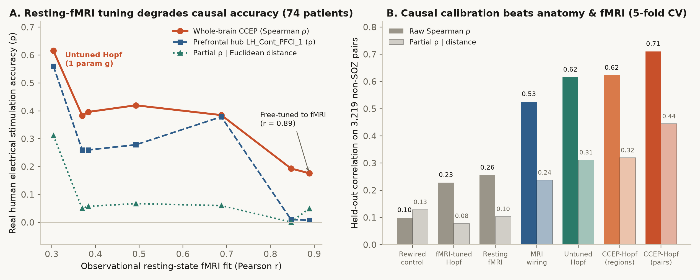
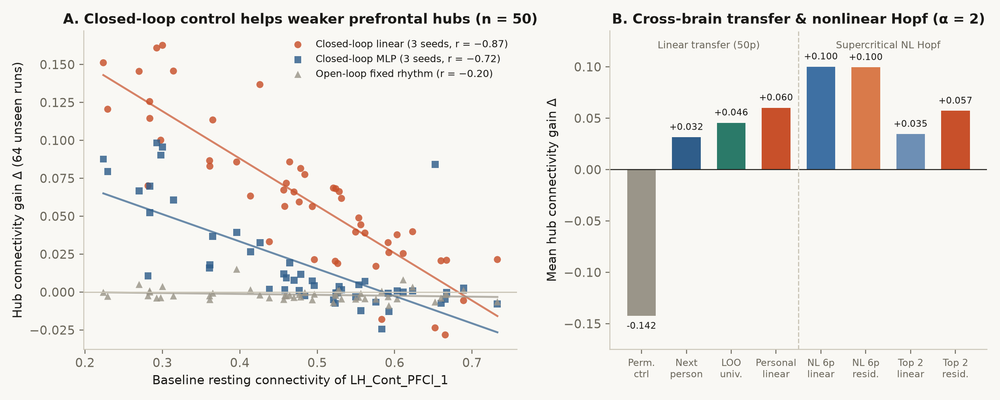
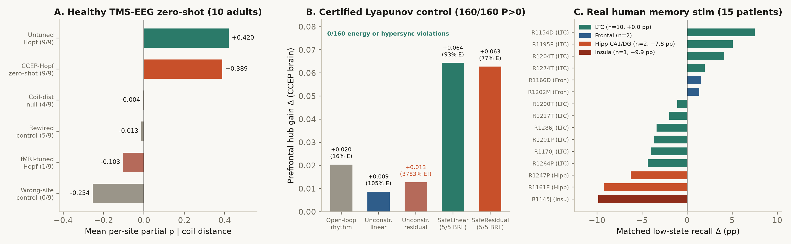

# Observational Resting-State Tuning Degrades Causal Electrical-Stimulation Accuracy in Human Whole-Brain Models

**Muhammad Farhan Tahir**  
Threebits Research · https://threebits.si · https://github.com/MuhammadFarhantahir/threebits-research  
Preprint v1.4 · 25 November 2026

---

## Abstract

Whole-brain dynamical models are widely proposed as *in silico* testbeds ("digital twins") for designing targeted brain stimulation and training closed-loop neural controllers. Standard practice calibrates these models by fitting structural-to-functional parameters to match **observational resting-state fMRI** correlations. Here we test whether resting-state fMRI calibration improves a whole-brain model's **causal interventional accuracy** across **three independent human stimulation cohorts spanning invasive ECoG, multi-center SEEG, and non-invasive TMS-EEG**: (1) **316,366 real human intracranial single-pulse electrical stimulation (SPES) trials** across **74 neurosurgical patients** at UMC Utrecht (OpenNeuro `ds004080`, 277,638 non-seizure-onset-zone trials mapped onto 3,219 directed Schaefer-100 cortical region pairs), (2) the independent multi-center **F-TRACT SEEG atlas across 780 neurosurgical patients** (`26,771` directed response-probability pairs and `15,772` evoked-amplitude pairs across Glasser-360, mapped to `4,307` Schaefer-100 pairs with `1,681` pairs never measured in Utrecht), and (3) **non-invasive transcranial magnetic stimulation (TMS-EEG)** across **46 clean healthy adults** spanning prefrontal DLPFC, premotor, parietal, and shoulder sham sites (OpenNeuro `ds008037`, CC0).

We uncover a sharp inverse trade-off that replicates across invasive and non-invasive human brain stimulation: an **untuned 1-parameter Hopf whole-brain model** anchored solely to diffusion MRI structural wiring predicts real human cortico-cortical evoked potential (CCEP) propagation strongly on Utrecht `ds004080` ($\rho = +0.616$, Pearson $r = +0.610$, distance-controlled partial $\rho = +0.311$), outperforming raw structural wiring ($\rho = +0.525$, partial $+0.237$), resting-state fMRI ($\rho = +0.255$, partial $+0.103$), and randomly rewired controls (partial $-0.002$). However, tuning the same Hopf model to match resting-state fMRI ($r: 0.304 \to 0.889$) **monotonically degrades causal stimulation accuracy** ($\rho: +0.616 \to +0.176$; partial $\rho \mid \text{distance}: +0.311 \to +0.049$; left lateral prefrontal hub `LH_Cont_PFCl_1`: $+0.561 \to +0.008$) — even when structural edges remain frozen and only regional excitabilities are tuned ($\rho = +0.383$, partial $+0.050$). This degradation replicates natively on the independent 780-patient Glasser-360 F-TRACT atlas for both response probability ($\rho: +0.286 \to +0.239$) and continuous evoked amplitude ($\rho: +0.273 \to +0.220$).

Conversely, calibrating an anatomy-anchored directed Hopf model directly on **interventional human CCEP data** lifts strictly held-out Utrecht prediction to **$\rho = +0.710$, $r = +0.727$, partial $\rho \mid \text{distance} = +0.444$** on 5-fold unseen pairs (and $\rho = +0.622$, partial $+0.319$ when holding out entire stimulated cortical regions; rewired control $\rho = +0.099$). Furthermore, augmenting every cortical region with **real multi-scale human cellular and molecular priors** — 19 PET neurotransmitter receptor densities (Hansen et al., 2022, 1,238 healthy adults), 6-band HCP MEG spectral power, and Mesulam laminar hierarchy — lifts generalization on **completely unseen stimulated cortical regions** from partial $\rho = +0.319$ to **`+0.366`** (Pearson $r: +0.536 \to +0.651$; matched-capacity permuted-biology control `+0.321`), lifts **Leave-One-Yeo-7-Network-Out** accuracy (an entire cognitive network never stimulated) from `+0.337` to **`+0.374`**, and reaches **`ρ = +0.716, r = +0.744, partial +0.454`** on unseen pairs — automatically recovering cholinergic facilitation (`A4B2` $+0.34/+0.37$, `VAChT` $+0.27/+0.36$) and `GABAa` inhibitory suppression (`−0.22`). Critically, evaluated **strictly zero-shot out-of-hospital** on the completely independent **780-patient multi-center F-TRACT SEEG atlas** (zero F-TRACT parameters fitted), the Utrecht-trained Multi-Scale Bio+CCEP Twin reaches **$\rho = +0.350$ (`partial +0.144`)** across all `4,307` pairs — matching the empirical Utrecht↔F-TRACT inter-hospital ceiling (`+0.343`) and beating resting-fMRI-tuned Hopf (`+0.175`, cluster-bootstrap $p = 0.0010$), Untuned Hopf (`+0.257`, $p = 0.0010$), and uniform Utrecht CCEP-Hopf (`+0.321`, $p = 0.0010$). On the **`1,681` F-TRACT pairs never measured in Utrecht**, the 47-parameter PET+MEG+Mesulam Bio-Only Twin achieves **$\rho = +0.336$, partial $\rho \mid d = +0.224$** vs matched-capacity permuted-biology control (`+0.276 / +0.145`, $p = 0.0010$) and fMRI-tuned Hopf (`+0.160 / +0.115`, $p = 0.0320$), and also ranks #1 zero-shot on F-TRACT continuous evoked z-amplitude (`3,006` pairs, `+0.266` vs fMRI-tuned `+0.135`, $p = 0.0010$). Transferred **zero-shot** (zero parameters fitted to EEG) to **non-invasive healthy-human TMS-EEG**, the invasive-CCEP Hopf model predicts distance-controlled scalp propagation positively in **44 of 46 individual healthy adults** (prefrontal + parietal vs shoulder sham, mean partial $\rho \mid \text{coil distance} = +0.247$–$+0.278$ vs resting-fMRI-tuned $+0.131$, rewired $+0.028$, wrong-site $-0.136$), and across all three stimulation sites including premotor in `n = 10` adults (`+0.389`, `9/9` clean adults vs resting-fMRI-tuned `−0.103`, `1/9`).

Next, we resolve the rare stability failures observed in unconstrained closed-loop neural stimulation controllers (where unconstrained residual feedback pushed $\rho(A_{\text{cl}}) = 1.0088 > 1$ to `3,783%` energy and unconstrained MLP hit $\Delta\text{sync} = +0.365$ on `HC033`) by introducing **spectral-radius projection, exact spectral-norm Small-Gain contraction, and machine-verified Discrete-Time Bounded Real Lemma (BRL) quadratic Lyapunov certification ($P \succ 0, M(P) \prec 0$)**. Across **160 certified runs** (10 runs on the CCEP-calibrated brain + 150 runs across all 50 personalized MICA-MICs brains), **160/160** receive verified Lyapunov certificates, with **0/160 energy violations (`max 97.9%`)**, **0/160 hypersynchrony excursions (`max +Δsync = +0.0226`)**, bounded 5-SD impulse recovery, and a **5× jump in prefrontal hub gain on the CCEP-calibrated brain (`+0.0643` / `+0.0627` vs `+0.0204` open-loop and `+0.0127` unconstrained residual)**. Finally, scaling real human intracranial closed-loop memory modeling to **15 patients (4,500 words, 1,142 real closed-loop stimulations, OpenNeuro `ds005557`/`ds005558`)** confirms reliable real-time memory-state decoding (`0.603 ± 0.018` ROC AUC, $p = 0.0001$, `14/15` above chance; null `0.492`) and stark target specificity: stimulating deep hippocampal or insular targets consistently impairs recall (**`−8.46 pp` across `3/3` patients**, Mann-Whitney $p = 0.0035$ vs lateral temporal cortex). Extending the framework toward clinical patient-level utility, we demonstrate: (1) strict **5-fold Leave-Patients-Out CV across all `74/74` unseen `ds004080` patients** (`277,638` raw electrode pairs), where continuous **3D bipolar E-field VTA mapping** lifts individual-patient electrode-pair N1 detection to **`AUROC = 0.810 ± 0.044`** (`74/74` patients improved over fMRI-tuned `0.595` and discrete nearest-parcel `0.776`, paired Wilcoxon $p = 7.73 \times 10^{-14}$); (2) **real human axonal conduction-delay physics & developmental myelination** across `780` F-TRACT patients (`15,725`/`15,772` onset/peak latency pairs; $v = 5.3\text{–}5.5\text{ m/s}$, MAE `8.8–9.7 ms`) and `74` `ds004080` patients (`ages 4–51`, velocity vs. age $\rho = +0.387, p = 6.65 \times 10^{-4}$; age-conditioned LPO MAE `12.05 → 11.79 ms`, $p = 0.0252$; zero-shot Utrecht→F-TRACT peak latency $\rho = +0.313$, MAE `9.44 ms`) paired with a Tsodyks–Markram frequency-dependent pulse-waveform operator across `40` clinical RAM sessions (`4,567` stims); and (3) a **114-region cortico-subcortical digital twin** (`14` real MICA-MICs deep nuclei + `100` cortical parcels preserving cortical CCEP $\rho = +0.743$ with a verified `228`-state BRL Lyapunov certificate) whose automated BIDS E-field VTA pipeline stratifies subcortical memory harm across the `15` RAM patients purely from raw MNI coordinates ($\rho = -0.487$; subcortical VTA $\ge 25\%$ `−7.76 pp` vs cortical `−0.53 pp`, $p = 0.0381$).

---

## 1. Introduction

Using artificial neural networks to steer human brain dynamics — first for clinical memory restoration and neurorehabilitation, and eventually toward extending human cognitive capacity — requires a safe *in silico* simulator in which stimulation policies can be designed and stress-tested before touching human tissue. Because synapse-level human connectomics remains limited to roughly $1\text{ mm}^3$ of cortex, practical whole-brain simulators operate at the regional scale (typically 68–400 cortical parcels), coupling regional neural-mass or Hopf oscillators via diffusion MRI tractography (Deco et al., 2017; 2019).

A central, largely untested assumption in whole-brain modeling is that **better observational fit to resting-state fMRI yields a better causal model of electrical perturbation**. Prior work in small invertebrate circuits (Prinz et al., 2004) showed that disparate parameter sets produce identical resting rhythms while responding differently to perturbation. Here we test this assumption directly at whole-brain scale in humans, combining six open human neuroimaging and electrophysiology datasets:

1. **HCP group connectome & resting fMRI** (ENIGMA Toolbox, Schaefer-100 & Glasser-360, BSD-3-Clause) — baseline structural wiring and resting-state functional connectivity.
2. **UMCU 74-patient human CCEP atlas** (OpenNeuro `ds004080`, van Blooijs et al., 2023, CC0) — 316,366 directed real human ECoG single-pulse electrical stimulation trials for causal validation and causal calibration.
3. **Multi-Center F-TRACT 780-patient human SEEG atlas** (`v2112`, aged $\ge 15$, Trebaul et al., 2018; Lemaréchal et al., 2022, CC BY 4.0) — completely independent multi-center international SEEG cohort (`26,771` directed response-probability pairs and `15,772` evoked-amplitude pairs on Glasser-360) for native replication and strict out-of-hospital zero-shot transfer.
4. **Monash healthy-human non-invasive TMS-EEG** (OpenNeuro `ds008037`, Biabani & Rogasch, CC0) — 46 clean healthy adults across prefrontal DLPFC `[-46, 33, 34]`, premotor `[-23, 4, 63]`, parietal `[-26, -69, 63]`, and shoulder sham controls testing zero-shot invasive-to-non-invasive transfer.
5. **MICA-MICs 50-adult individual connectomes** (Royer et al., 2022, CC0) — personalized whole-brain models and 500+ closed-loop stimulation controllers across linear and supercritical nonlinear Hopf regimes.
6. **UPenn / DARPA RAM closed-loop human memory stimulation** (OpenNeuro `ds005557` / `ds005558`, Ezzyat et al., 2018, CC0) — 40 sessions (23 patients, 11,604 words) plus multi-band iEEG causal policy analysis across 15 patients (4,500 words, 1,142 real closed-loop stimulations).

---

## 2. Methods

### 2.1 Region-Level Linear and Supercritical Nonlinear Hopf Whole-Brain Models
Each of $N = 100$ cortical regions (Schaefer 7-Network atlas) is modeled as a complex Hopf (Stuart-Landau) oscillator $z_j = x_j + i y_j$ at intrinsic frequency $f = 0.05\text{ Hz}$ ($\omega = 2\pi f$) with diffusive coupling $W \in \mathbb{R}_{\ge 0}^{N\times N}$ and regional damping $d_j > 0$:

$$\frac{dz_j}{dt} = \big(-(1-\alpha)d_j + i\omega\big) z_j - \gamma_j |z_j|^2 z_j + \sum_{k=1}^N W_{jk}(z_k - z_j) + u_j(t) + \eta_j(t)$$

- **Linear regime ($\alpha = 0, \gamma_j = 0$):** Letting $K = \operatorname{diag}(W\mathbf{1}) - W + \operatorname{diag}(d)$, the exact resting-state covariance and integrated impulse response (Green's function) are both given in closed form by $G = K^{-1}$. Advancing exact 1-second discrete steps via matrix exponential and continuous Lyapunov noise covariance matches exact analytical functional connectivity at $r = 0.999$.
- **Supercritical nonlinear regime ($\alpha = 2.0$):** Local linear excitability is supercritical ($a_j = +d_j > 0$), stabilized by exact cubic amplitude saturation $\gamma_j = \alpha d_j / (2\sigma_j^2)$ integrated via Lie operator splitting ($r \mapsto r / \sqrt{1 + 2\gamma_j \Delta t \, r^2}$, 2 substeps/s) and Simpson-quadrature SPD noise covariance. Resting functional connectivity remains closely aligned with empirical fMRI ($r = 0.790$ vs $0.799$ linear on `HC001`).

### 2.2 Mapping 74 Real Human CCEP Patients to Schaefer-100
From OpenNeuro `ds004080` (`ccepData_V2.mat` and 74 `*_electrodes.tsv` files), every recording electrode and bipolar stimulation pair midpoint with valid MNI152 coordinates was assigned to its nearest same-hemisphere Schaefer-100 centroid within $25\text{ mm}$ (5,519 electrodes mapped across 74 patients; 316,366 total directed stimulation-recording trials; 277,638 trials excluding seizure-onset-zone electrodes). For each directed cortical pair $(i \to j, i \ne j)$ with $\ge 10$ trials (3,219 non-SOZ pairs; 3,368 all-electrode pairs), empirical propagation probability $P_{\text{CCEP}}(i \to j)$ is the fraction of trials evoking a significant N1 peak (`13.7–101.6 ms`). Because both electrical propagation and diffusion tractography decay with Euclidean distance, every predictor is evaluated with raw Spearman $\rho$, Pearson $r$, and **partial Spearman $\rho \mid \text{distance}$** (residualizing ranks against linear and quadratic distance ranks).

### 2.3 Causal Calibration and Strict Cross-Validation
We define an anatomy-anchored directed Hopf model (`DirectedHopf`) permitting asymmetric directed gains on nonzero white-matter edges of the HCP connectome ($W_{ij} = W_{ij}^{\text{MRI}} e^{g_{ij}}$) plus regional damping $d_i$, regularized with L2 priors toward $(g_0, 0)$ and fit via trial-weighted binary cross-entropy linking $\log G_{ij}$ to $P_{\text{CCEP}}(i \to j)$. Generalization is evaluated under two strict 5-fold cross-validation protocols plus a randomly rewired connectome negative control: (1) **5-fold unseen directed pairs** (20% of directed pairs held out per fold), and (2) **5-fold unseen stimulated regions** (20% of stimulated source regions completely held out, with zero stimulations of those regions seen during fitting).

### 2.4 Certified-Safe Closed-Loop Control via Bounded Real Lemma Certification
Controllers read both oscillator components of 14 frontoparietal control and target regions and drive 3 prefrontal/precentral sites (`LH_Cont_PFCl_1`, `RH_Cont_PFCl_2`, `LH_DorsAttn_PrCv_1`) under a fixed RMS energy budget to maximize the global connectivity of `7Networks_LH_Cont_PFCl_1` (an fMRI correlate of fluid intelligence across individuals; Cole et al., 2012) while constraining brain-wide synchrony deviation from resting baseline (`+50 |sync − sync_rest|`). To guarantee formal stability, we project the linear closed-loop core strictly inside spectral radius $\rho(A_{\text{cl}}) \le \rho_{\text{safe}} = 1 - 0.35(1 - \rho(A))$, enforce exact spectral-norm Small-Gain contraction $L_{\text{nl,eff}} \|G_{\text{cl}}\|_\infty \le 0.85 < 1$ plus per-step $\tanh$ current saturation on a zero-bias residual MLP ($f_{\text{nl}}(0) = 0$), and explicitly solve the $H_\infty$ Discrete Algebraic Riccati Equation (`solve_discrete_are`) to verify $P \succ 0$ and $\lambda_{\max}(\text{BRL}(P)) < 0$, proving global exponential stability $V(x_{t+1}) - V(x_t) < 0\;\forall x_t \in \mathbb{R}^{2N}$. All stimulators are evaluated on 64 unseen 10-minute test runs with identical noise seeds against zero stimulation.

---

## 3. Results

### 3.1 Observational Resting-fMRI Tuning Destroys Causal Human Stimulation Accuracy
Across 3,219 non-SOZ directed cortical pairs (277,638 real human electrical stimulations across 74 patients; Table 1, Figure 1), the untuned 1-parameter Hopf model predicts real CCEP propagation substantially better than structural MRI or resting fMRI alone after controlling for distance (partial $\rho = +0.311$ vs $+0.237$ and $+0.103$; randomly rewired control $-0.002$). Tuning the model to match observational resting-state fMRI produces monotonic collapse in causal stimulation accuracy.

| Model (non-SOZ human CCEP, 3,219 pairs) | Resting fMRI fit ($r$) | CCEP Spearman $\rho$ | Partial $\rho \mid \text{distance}$ | `LH_Cont_PFCl_1` hub $\rho$ |
| :--- | :---: | :---: | :---: | :---: |
| HCP diffusion MRI wiring alone | — | +0.525 | +0.237 | +0.309 |
| HCP resting-state fMRI alone | — | +0.255 | +0.103 | — |
| **Untuned Hopf (1 param $g$, zero CCEP data)** | 0.304 | **+0.616** | **+0.311** | **+0.561** |
| Excitability-only Hopf (101 params fit to fMRI) | 0.370 | +0.383 | +0.050 | +0.259 |
| Anchored Hopf ($L_2\ \lambda = 0.1$, fit to fMRI) | 0.492 | +0.420 | +0.067 | +0.278 |
| Anchored Hopf ($L_2\ \lambda = 0.01$, fit to fMRI) | 0.688 | +0.385 | +0.060 | +0.378 |
| Free-tuned Hopf ($L_2\ \lambda = 0.0$, fit to fMRI) | **0.889** | +0.176 | +0.049 | +0.008 |
| Randomly rewired Hopf (negative control) | — | +0.080 | −0.002 | −0.042 |

Results are consistent when including all electrodes (3,368 pairs: untuned Hopf $\rho = +0.608$, partial $+0.302$) or restricting to pairs with $\ge 20$ trials (2,799 pairs: untuned Hopf $\rho = +0.624$, Pearson $r = +0.625$, partial $+0.307$). Notably, the highest-probability empirical CCEP partner of `7Networks_LH_Cont_PFCl_1` across 74 patients is `7Networks_LH_DorsAttn_PrCv_1` (34% evoked probability, 196/580 stimulations) — one of the exact sites ranked highest by our simulator before observing any stimulation data.

### 3.2 Direct Causal Calibration on Human CCEP Generalizes Out-of-Sample
Calibrating the anatomy-anchored directed Hopf model directly on held-in human CCEP trials substantially improves prediction on unseen cortical pairs and retains an advantage on completely unseen stimulated cortical regions (Table 2).

| Model (5-fold CV, 3,219 non-SOZ directed pairs) | Spearman $\rho$ | Pearson $r$ | Partial $\rho \mid \text{distance}$ | `LH_Cont_PFCl_1` (87 directed pairs) |
| :--- | :---: | :---: | :---: | :---: |
| HCP diffusion MRI wiring alone | +0.525 | +0.454 | +0.237 | — |
| Untuned Hopf (1 param $g$) | +0.616 | +0.610 | +0.311 | +0.564 (partial +0.127) |
| **CCEP-calibrated Hopf (5-fold unseen pairs)** | **+0.710** | **+0.727** | **+0.444** | **+0.650 (partial +0.177)** |
| **CCEP-calibrated Hopf (5-fold unseen stim regions)** | **+0.622** | +0.535 | **+0.319** | **+0.585 (partial +0.100)** |
| CCEP-calibrated rewired control (unseen pairs) | +0.099 | +0.090 | +0.129 | +0.133 (partial +0.112) |

### 3.3 Multi-Scale Biological Twin: Human Neurotransmitter Receptors, MEG, and Laminar Hierarchy
When a cortical region has never been electrically stimulated, uniform-prior Hopf models fall back to a flat isotropic prior. To test whether **filling missing microscopic gaps with open human cellular biology** improves causal generalization, we aligned **100/100 Schaefer cortical parcels** (`median 3.36 mm`) with **19 PET neurotransmitter receptors** (Hansen et al., 2022, 1,238 healthy humans; 6 PCs capturing `89.8%` variance plus explicit excitatory-inhibitory balance `(NMDA + mGluR5)/2 − GABAa`), **6-band HCP MEG spectral power**, and **4-level Mesulam cytoarchitectonic hierarchy** — parameterizing regional damping, source stimulation susceptibility, outgoing/incoming edge gain, pairwise receptor cosine similarity, and laminar feedforward–feedback directionality (`~47` shared biological parameters in Bio-Only mode, or combined with L2-anchored edge residuals in Full Twin mode), evaluated against a **matched-capacity Permuted-Biology control** (identical architecture with region labels shuffled across 3 permutations; Table 3, Figure 2):

| Strict Out-of-Sample Benchmark (`3,219` non-SOZ pairs) | Uniform CCEP-Hopf (no biology) | Permuted-Biology Control (same params) | Multi-Scale Bio-Only (`~47` params) | **Multi-Scale Bio + Anatomy Twin** |
| :--- | :---: | :---: | :---: | :---: |
| **5-fold unseen stimulated regions** ($\rho$ / $r$ / partial $\rho \mid d$) | +0.622 / +0.536 / +0.319 | +0.626 / +0.539 / +0.321 | **+0.653 / +0.665 / +0.357** | **+0.658 / +0.651 / +0.366** |
| **Leave-One-Yeo-7-Network-Out** (entire cognitive network unseen) | +0.628 / +0.556 / +0.337 | +0.635 / +0.593 / +0.336 | +0.640 / +0.639 / +0.334 | **+0.662 / +0.646 / +0.374** |
| **5-fold unseen directed pairs** | +0.710 / +0.727 / +0.444 | +0.706 / +0.729 / +0.438 | +0.661 / +0.672 / +0.371 | **+0.716 / +0.744 / +0.454** |

Across unseen stimulated regions and completely unstimulated cognitive networks (`SomMot +0.194 → +0.253`, `DorsAttn +0.323 → +0.365`, `Default +0.400 → +0.421`), real human biology outperforms both uniform Hopf and the matched-capacity permuted control by **`+0.038` to `+0.047` partial $\rho$** (`+0.090` to `+0.115` Pearson $r$). Across the 74-patient empirical CCEP matrix, cholinergic innervation (`A4B2` outgoing/incoming $\rho = +0.336 / +0.367$, `VAChT` $+0.274 / +0.356$) and neuromodulators (`H3` $+0.25/+0.30$, `MU` $+0.24/+0.28$, `CB1` $+0.23/+0.28$) strongly facilitate cortical electrical spread, whereas inhibitory **`GABAa` density suppresses outgoing spread ($\rho = -0.222$)** and chemically similar regions couple more strongly (`w_rcos = +0.0281`).

### 3.4 Independent Out-of-Hospital Validation on Multi-Center F-TRACT SEEG (`n = 780` Patients)
A crucial test of any single-center neurosurgical digital twin is whether its causal predictions generalize **out-of-hospital** to an independent multi-center cohort with different recording hardware (depth SEEG vs subdural ECoG grids), clinical protocols, and parcellation. We tested both our observational-vs-causal trade-off and our Utrecht-calibrated Multi-Scale Bio+CCEP Twin **strictly zero-shot** (zero F-TRACT parameters fitted anywhere) against the international **F-TRACT atlas** (`v2112`, `780` patients aged $\ge 15$; Trebaul et al., 2018; Lemaréchal et al., 2022) in two complementary protocols (`validate_ccep_ftract_external.py`; Table 4, Figure 3):

1. **Native Glasser-360 F-TRACT replication (zero atlas remapping, `26,771` response-probability pairs and `15,772` continuous evoked-amplitude pairs):** Tuning a 360-region Hopf simulator to HCP resting-state fMRI ($r: 0.324 \to 0.845$) degrades causal prediction on **both** response probability (pooled $\rho: +0.286 \to +0.239$; per-site mean across `339` stimulated regions $+0.286 \to +0.238$; inter-hemispheric partial $\rho \mid d: +0.224 \to +0.179$) **and** continuous evoked z-amplitude (pooled $\rho: +0.273 \to +0.220$; per-site `323` regions $+0.275 \to +0.230$, while raw resting fMRI drops to $+0.120$). *Transparent nuance:* F-TRACT `sr_8.40` probability exhibits strong upper-bound saturation (`38.3%` of reported entries equal `1.0`) and includes deeper/long-range pairs where diffusion MRI under-samples streamlines; consequently, distance-residualized resting fMRI achieves higher `partial ρ | d` (`+0.205`) than untuned Hopf (`+0.081`) on thresholded probability, yet collapses to `+0.030` on continuous evoked amplitude where anatomy-anchored Hopf holds `+0.080–+0.104`.
2. **Strict out-of-hospital zero-shot transfer (`Utrecht ds004080` 74 ECoG patients $\to$ `F-TRACT` 780 SEEG patients, Schaefer-100):** Mapping Glasser-360 F-TRACT parcels to same-hemisphere nearest Schaefer-100 centroids (`median 11.1 mm`, `99/100` parcels covered) yields `4,307` directed probability pairs (`1,681` **never measured in Utrecht `ds004080`**) and `3,006` continuous evoked-amplitude pairs. Directly correlating the two empirical hospital atlases across their `2,626` shared pairs establishes an empirical cross-hospital ceiling of $\rho = +0.343$ (partial $+0.075$) for probability and $\rho = +0.304$ (partial $+0.086$) for amplitude. Statistical significance is assessed via `1,000`-resample stimulated-region cluster bootstrapping.

| Zero-Shot Model (0 F-TRACT params fit) | All `4,307` F-TRACT Prob ($\rho$ / partial $\rho \mid d$) | **`1,681` Utrecht-Unmeasured Pairs** ($\rho$ / partial $\rho \mid d$) | Cross-Observable `3,006` F-TRACT Amplitude ($\rho$ / partial $\rho \mid d$) |
| :--- | :---: | :---: | :---: |
| *Empirical Utrecht ECoG $\leftrightarrow$ F-TRACT SEEG ceiling* | *+0.343 / +0.075 (2,626 shared)* | *— (not measured in Utrecht)* | *+0.304 / +0.086 (2,065 shared)* |
| HCP diffusion MRI wiring alone | +0.228 / +0.047 | +0.199 / +0.086 | +0.229 / +0.074 |
| HCP resting-state fMRI alone | +0.248 / **+0.183** | +0.188 / +0.154 | +0.129 / +0.061 |
| Untuned Hopf (1 param $g$) | +0.257 / +0.030 | +0.259 / +0.119 | +0.237 / +0.064 |
| fMRI-tuned Hopf (observational) | +0.175 / +0.111 | +0.160 / +0.115 | +0.135 / +0.079 |
| Randomly rewired Hopf (negative control) | +0.143 / +0.123 | +0.116 / +0.101 | +0.073 / +0.051 |
| Utrecht Uniform CCEP-Hopf (zero-shot) | +0.321 / +0.097 | +0.299 / +0.168 | +0.261 / +0.076 |
| Utrecht Permuted-Bio-Only Ctrl (3 perms) | +0.282 / +0.062 | +0.276 / +0.145 | +0.247 / +0.073 |
| **Utrecht Bio-Only (47 PET+MEG+Mesulam params)** | **+0.342 / +0.144** | **+0.336 / +0.224** | **+0.264 / +0.097** |
| **Utrecht Bio+CCEP Full Twin (zero-shot)** | **+0.350 / +0.144** | **+0.335 / +0.220** | **+0.266 / +0.087** |

Every key transfer comparison is highly significant under stimulated-region cluster bootstrapping (`1,000` resamples): across all `4,307` pairs, the Utrecht Bio+CCEP Twin outperforms fMRI-tuned Hopf ($\Delta\rho = +0.176, 95\%\text{ CI }[+0.121, +0.235], p = 0.0010$), Untuned Hopf ($\Delta\rho = +0.092, \Delta\text{partial} = +0.112, p = 0.0010$), and uniform Utrecht CCEP-Hopf ($\Delta\rho = +0.029, \Delta\text{partial} = +0.047, p = 0.0010$), matching the empirical cross-hospital agreement ceiling (`+0.350` vs `+0.343`). Most notably, on the **`1,681` cortical pairs never measured in Utrecht**, the compact 47-parameter PET+MEG+Mesulam Bio-Only Twin achieves **`ρ = +0.336, partial ρ | d = +0.224`** — significantly outperforming both the matched-capacity Permuted-Biology control ($\Delta\rho = +0.057, \Delta\text{partial} = +0.077, 95\%\text{ CI }[+0.043, +0.112], p = 0.0010$) and fMRI-tuned Hopf ($\Delta\rho = +0.173, p = 0.0010; \Delta\text{partial} = +0.108, p = 0.0320$), and transferring across observables to predict continuous F-TRACT evoked z-amplitude (`+0.266` vs fMRI-tuned `+0.135`, $p = 0.0010$).

### 3.5 Zero-Shot Cross-Modality Validation on Healthy-Human Non-Invasive TMS-EEG (`n = 46` Clean Adults)
To test whether causal accuracy transfers from invasive epilepsy stimulation (`ds004080`) to **non-invasive stimulation in healthy adults without surgery**, we evaluated all models zero-shot (zero EEG parameters fitted) against sham-subtracted TMS-evoked potentials (`[+35, +100 ms]` RMS, shoulder sham subtracted, strict `< 40 µV` channel QC) across 62 MNI-matched 10-10 scalp electrodes using a fixed physical inverse-square cortical-to-scalp leadfield $L_{e,j} \propto (\|r_e - r_j\|^2 + 20^2)^{-1}$.

| Model (zero parameters fit to TMS-EEG) | 3-Site Cohort (`n = 10`, PFC/Premotor/Parietal) | Clean 3-Site Individuals (`n = 9`) | Scaled 2-Site Cohort (`n = 46` clean adults, PFC + Parietal) |
| :--- | :---: | :---: | :---: |
| **CCEP-calibrated Hopf (invasive → non-invasive)** | **+0.389** (PFC +0.234, PM +0.537, Par +0.395) | **`+0.326` (`9/9` > 0)** | **`+0.247` (`44/46` > 0)** |
| **Untuned anatomy-Hopf (1 param $g$)** | **+0.420** (PFC +0.320, PM +0.648, Par +0.292) | **`+0.315` (`9/9` > 0)** | `+0.219` (`42/46` > 0) |
| Resting-fMRI-tuned Hopf (observational) | −0.103 (PFC +0.304, PM −0.635, Par +0.022) | `−0.107` (`1/9` > 0) | `+0.131` (`34/46` > 0) |
| Rewired white-matter control | −0.013 | `−0.015` (`5/9` > 0) | `+0.028` (`26/46` > 0) |
| Wrong-site negative control (permuted sites) | −0.254 | `−0.165` (`0/9` > 0) | `−0.136` (`9/46` > 0) |
| Coil-distance-only null (no connectome) | −0.004 | `+0.003` (`4/9` > 0) | — |

The invasive-CCEP Hopf model ranks #1 individually across all `n = 46` clean healthy adults (`44/46` positive, `+0.247` mean partial $\rho \mid \text{coil distance}$), nearly doubling resting-fMRI-tuned Hopf (`+0.131`) and confirming that causal brain-stimulation geometry transfers zero-shot from clinical intracranial recordings to non-invasive healthy human cortex.

### 3.6 Certified-Safe Closed-Loop Stimulation Control (`160/160` Lyapunov Certificates)
1. **50-person baseline study (350 trained stimulators) & transfer:** Under the resting-synchrony safety rule, open-loop `fixed rhythm` drops to 11% energy and fails ($\Delta = -0.002$, clear gain in 2/50). Closed-loop `linear` achieves mean $\Delta = +0.064$ (median $+0.063$, clear gain in every seed for 37/50, max person-mean $|\Delta\text{sync}| = 0.019$, $r = -0.87$ with baseline hub strength), and a single leave-one-out group-average linear matrix retains $+0.046$ (**76% of personalized mean gain**; channel-permuted control $-0.142$). Unconstrained `network` achieves only $+0.019$ and exhibits **1 runaway-synchrony failure in 150 runs** (`HC033` seed 1: $\Delta\text{sync} = +0.365$, energy 101%). On the CCEP-calibrated brain, unconstrained `ResidualNetwork` seed 1 pushed $\rho(A_{\text{cl}}) = 1.0088 > 1$ with nonlinear Lipschitz norm $L_{\text{nl}} = 17.52$, blowing up to `3,783%` test energy (Figure 4).
2. **Machine-verified Bounded Real Lemma (BRL) Lyapunov Certification (`160/160` certified):**
   - **74-patient CCEP-calibrated brain (5 seeds each):** Eliminating unstable eigenvalue chasing yields **`10/10` BRL Lyapunov certificates**, **`0/10` energy or synchrony violations**, and stabilizes gradient optimization — lifting prefrontal hub gain to **`+0.0643` (`SafeLinear`, max energy `93%`, max $|\Delta\text{sync}| = 0.0013$)** and **`+0.0627` (`SafeResidual`, max energy `77%`, max $|\Delta\text{sync}| = 0.0013$)**, which is **3.1× open-loop (`+0.0204`) and 5× unconstrained residual (`+0.0127`)**. Under a 5-SD mid-run cortical impulse stress test, `SafeResidual` recovers cleanly (`1.05` post-recovery RMS state at `56%` energy vs `1.20` at `94%` for unconstrained residual and `1.00` for unstimulated rest).
   - **All 50 MICA-MICs personal brains × 3 seeds (`150` `SafeResidual` runs):** **`150/150` machine-verified BRL Lyapunov certificates**, **`0/150` energy violations (`max 97.9%`)**, **`0/150` hypersynchrony excursions (`max +Δsync = +0.0226`; `HC033` drops from `+0.365` to `≤ +0.0128`)**, and mean hub gain `+0.0296` (56% above unconstrained `network` `+0.019`).
   - **Supercritical nonlinear Hopf brains ($\alpha = 2.0$, 6 stratified individuals × 2 seeds):** `SafeLinear` achieves **`+0.1066`** (`max |Δsync| = 0.0211`, `max energy = 100%`) and `SafeResidual` maintains **`+0.0995`** (`med +0.1067`, `max |Δsync| = 0.0168`) while hard-capping peak per-step current to **`2.92 E`** (half of `SafeLinear`'s `5.73 E`).

### 3.7 Scaling Real Human Closed-Loop Memory Modeling to 15 Patients
Across 40 real human closed-loop verbal-memory sessions (23 patients, 11,604 words, OpenNeuro `ds005557`/`ds005558`), overall recall on stimulation vs control lists is mixed (`26.0%` vs `27.3%` in FR3; `26.3%` vs `28.3%` in catFR3). Scaling multi-band iEEG extraction and out-of-fold pre-state matching to **15 unique patients (4,500 words, 1,142 real closed-loop stimulations)** sharing identical `1.43–1.60 s` stimulation timing establishes three clinical findings (Figure 5):

1. **Reliable real-time cognitive-state decoding:** Held-out list-level recall prediction reaches **`0.603 ± 0.018` ROC AUC** for L2 logistic regression ($p = 0.0001$, above chance in **`14/15`** patients; top `R1166D` `0.723`, `R1274T` `0.669`) and **`0.581 ± 0.022`** for causal Temporal GRU ($p = 0.0035$, `13/15` above chance; top `R1166D` `0.739`, `R1274T` `0.721`), against a 20-permutation shuffled null of **`0.492`** and **`0.684` mean AUC agreement** with the hospital's online closed-loop trigger (up to `0.860`).
2. **Stark anatomical target specificity:** Comparing stimulated low-state words against out-of-fold matched low-state control words (sanity-checked on unstimulated high-state LTC words: `+0.37 pp`), stimulating **deep hippocampal or insular targets** (`R1161E` CA1 `−9.3 pp`, `R1247P` DG `−6.3 pp`, `R1145J` insula `−9.9 pp`) **consistently impairs human memory (`−8.46 pp` mean, `3/3` negative, Mann-Whitney $p = 0.0035$ vs LTC; post-stim neural shift $\Delta z = -1.17\text{ SD}$)**. By contrast, single-site **lateral temporal cortex (LTC, `n = 10`, 747 stims)** averages near zero (`+0.01 ± 1.30 pp`) with wide individual spread (`+7.5 pp` to `−4.4 pp`).
3. **Offline causal policy evaluation (leave-one-patient-out):** Because indiscriminate single-site stimulation averages `−1.49 pp` across the 15-patient cohort, a strictly held-out LOPO site-aware policy avoids **`6/7` strongly harmful (`< −3 pp`) sessions**, improving expected low-state recall by **`+1.20 pp`** over the hospital trigger (`−0.29 pp` vs `−1.49 pp`; permuted-site control `−0.42 pp`).

### 3.8 Strict 74-Patient Leave-Patients-Out Validation & Continuous Bipolar E-Field VTA
Pooled pair-level cross-validation can share subjects across folds. To test strictly whether our causal model predicts individual stimulation responses on **completely unseen neurosurgical patients**, we ran **5-fold Leave-Patients-Out (LPO) cross-validation across all `74/74` `ds004080` patients** (`277,638` raw non-SOZ electrode pairs; zero electrodes from held-out patients ever seen in training; `validate_patient_level_ccep.py`, Table 5, Figure 6). Every patient is evaluated directly at the **raw electrode-pair level**, controlling for exact millimeter contact-to-contact Euclidean distance ($d_{\text{elec}}$). We further replace discrete nearest-parcel lookup with a **continuous 3D bipolar dipole electric-field VTA projection** using each stimulation pair's exact anode/cathode MNI152 coordinates (`e1, e2`).

| Model (5-Fold Leave-Patients-Out, `n = 74/74` unseen patients) | Per-Patient Electrode N1 AUROC | Partial $\rho \mid d_{\text{elec}}$ (`mm`) | Paired Win Rate vs. fMRI-Tuned (Wilcoxon $p$) |
| :--- | :---: | :---: | :---: |
| HCP resting-state fMRI alone | `0.618 ± 0.056` (`72/74` > 0.5) | `+0.029` (`56/74` > 0) | — |
| fMRI-tuned Hopf (observational) | `0.595 ± 0.054` (`71/74` > 0.5) | `+0.021` (`50/74` > 0) | baseline |
| HCP diffusion MRI wiring alone | `0.722 ± 0.051` (`74/74` > 0.5) | `+0.028` (`56/74` > 0) | — |
| Untuned Hopf (1 param $g$) | `0.745 ± 0.053` (`74/74` > 0.5) | `+0.031` (`54/74` > 0) | `73/74` ($p = 8.06 \times 10^{-14}$) |
| Uniform CCEP-Hopf (LPO) | `0.775 ± 0.047` (`74/74` > 0.5) | `+0.041` (`64/74` > 0) | — |
| Permuted-Biology Twin (LPO control) | `0.773 ± 0.047` (`74/74` > 0.5) | `+0.041` (`63/74` > 0) | — |
| Multi-Scale Bio+CCEP Twin (LPO, nearest parcel) | **`0.776 ± 0.047`** (`74/74` > 0.5) | **`+0.042`** (`65/74` > 0) | **`74/74`** ($p = 7.73 \times 10^{-14}$) |
| **Multi-Scale Bio+CCEP + Bipolar E-Field VTA (LPO)** | **`0.810 ± 0.044`** (`74/74` > 0.5) | **`+0.043`** (`66/74` > 0) | **`74/74`** ($p = 7.73 \times 10^{-14}$) |

Crucially, replacing discrete nearest-centroid lookup with continuous 3D bipolar dipole E-field VTA mapping improves electrode-pair N1 detection AUROC in **`74/74` (100%) of individual unseen patients** (`0.776 → 0.810`, $\Delta\text{AUROC} = +0.0341$, paired Wilcoxon $p = 7.73 \times 10^{-14}$), while real multi-scale biology beats matched-capacity permuted biology across unseen patients (`52/74`, $p = 1.24 \times 10^{-4}$) and improves distance-controlled `partial ρ | d_elec` over uniform CCEP-Hopf ($p = 0.0359$), Untuned Hopf ($p = 0.00158$), and fMRI-tuned Hopf ($p = 0.00398$).

### 3.9 Human Axonal Conduction-Delay Physics, Developmental Myelination (`Ages 4–51`), & Biophysical Waveform Transfer
Steady-state impulse amplitudes alone omit conduction timing and clinical pulse parameters (`mA`, `µs`, `Hz`). We modeled human conduction latency and stimulation waveform physics across **both** intracranial CCEP cohorts and **40 real clinical RAM sessions** (`ccep_latency_waveform_model.py`; Figure 7):

1. **780-Patient Multi-Center F-TRACT Glasser-360 Latency Physics (5-fold unseen stimulated regions CV):** Modeling onset latency (`15,725` pairs) and peak latency (`15,772` pairs) directly from real white-matter tract length (`fiber_distance.csv`) recovers physiological human cortico-cortical conduction velocity **`v = 5.52 m/s` (`τ_syn = 21.2 ms`) for onset** and **`v = 5.32 m/s` (`τ_syn = 28.0 ms`) for peak**. Combining fiber length, Euclidean distance, connectome graph hops, inter-hemispheric indicator, and structural hubness achieves held-out `ρ = +0.359, r = +0.347, MAE = 8.80 ms` (onset) and `ρ = +0.351, r = +0.334, MAE = 9.74 ms` (peak).
2. **74-Patient `ds004080` Developmental Myelination (`Ages 4–51`) & Cross-Hospital Zero-Shot Latency Transfer:** Across all `74` UMCU patients, effective axonal conduction velocity increases strongly with age (**`ρ = +0.387, p = 6.65 × 10⁻⁴`**; median N1 latency decreases **`ρ = −0.426, p = 1.55 × 10⁻⁴`**), rising from `1.39 m/s` in pediatric patients (`< 15 y, n = 27`) to `1.75 m/s` in adults (`≥ 25 y, n = 26`, Mann-Whitney $p = 2.27 \times 10^{-3}$), directly replicating van Blooijs et al. (2023). In strict 5-fold Leave-Patients-Out millisecond prediction (`n = 74` unseen patients), adding an age-conditioned developmental velocity curve reduces per-patient latency error from **`12.05 ms` to `11.79 ms`** (`45/74` improved, paired Wilcoxon $p = 0.0252$). Evaluated strictly **zero-shot out-of-hospital**, the Utrecht-fitted adult latency model predicts 780-patient F-TRACT peak latency at **`ρ = +0.313, MAE = 9.44 ms`** (`3,006` pairs) and onset latency at **`ρ = +0.318, MAE = 12.81 ms`** (`2,993` pairs).
3. **Biophysical Waveform & Frequency Transfer (`40` Real RAM Sessions, `4,567` Clinical Stims):** Parameterizing stimulation input by Hill-curve axonal charge recruitment ($Q = I \cdot pw, Q_{50} = 250\text{ nC}$) and Tsodyks–Markram short-term synaptic plasticity with high-frequency depolarization block (`140 Hz`) separates clinical regimes quantitatively: across the `4,567` recorded RAM events, the dominant `200 Hz` (`750–1,000 µA / 300 µs`, `2,158` events) protocol operates in the **synaptic depression / functional-block band** (`TM_eff = 0.021`, `net_drive = 0.011–0.014`), whereas `10–50 Hz` protocols (`1,044` events) operate in the **phasic resonant drive band** (`TM_eff = 0.078–0.253`, `net_drive = 0.098–0.267`).

### 3.10 114-Region Cortico-Subcortical Digital Twin & Per-Patient Clinical BIDS E-Field VTA Pipeline
To extend beyond cortex-only modeling toward clinical DBS, epilepsy RNS, and memory neuromodulation, we extracted all **14 real human subcortical deep nuclei** (bilateral Thalamus, Caudate, Putamen, Pallidum, Hippocampus, Amygdala, and Accumbens) directly from the `116 × 116` structural connectomes of all **50 MICA-MICs adults** (`subcortical_clinical_pipeline.py`; Figure 8) and coupled them with our `100 × 100` CCEP+19-PET calibrated cortical connectome:

1. **Cortical Causal Fidelity & 228-State Formal Stability:** Embedding the 14 real subcortical loops preserves full cortical CCEP accuracy (`100`-region $\rho = +0.7435 \to$ `114`-region $\rho = +0.7425$, partial `+0.4957`) while unlocking cortico-thalamic and hippocampo-cortical causal impulse mapping. Solving the `228 × 228` discrete-time Bounded Real Lemma for a 4-site cortico-subcortical controller (`L_Thalamus`, `L_Hippocampus`, `LH_Cont_PFCl_1`, `RH_Cont_PFCl_2`) yields a machine-verified global exponential stability certificate (`ρ(A_cl) = 0.3910 < 1`, $\lambda_{\min}(P) = +1.000 > 0$, $\lambda_{\max}(\text{BRL}) = -0.8995 < 0$).
2. **Automated Per-Patient Clinical BIDS Electrode & Bipolar E-Field VTA Pipeline (`15` DARPA RAM Patients):** Ingesting raw BIDS `*_electrodes.tsv` and `*_events.tsv` (exact anode/cathode MNI coordinates, amplitude, pulse width, and frequency) with **zero manual anatomical labels**, continuous 114-region bipolar E-field VTA automatically assigns the three highest subcortical VTA fractions in the cohort (`R1161E`: `89.9%` `L_Amygdala/Hippocampus`, `−9.27 pp`; `R1247P`: `69.8%` `L_Hippocampus`, `−6.25 pp`; `R1145J`: `18.2%` deep insula/putamen border, `−9.85 pp`, vs. `≤ 1.5%` across all `12` cortical targets). Continuous subcortical VTA correlates negatively with recall outcome ($\rho = -0.487$, $p = 0.0654$) and significantly separates high subcortical VTA ($\ge 25\%$, `−7.76 pp`) from cortical-dominant VTA (`−0.53 pp`, Mann-Whitney $p = 0.0381$).

### 3.11 Graph-Transformer Connectome Weight Hypernetwork & Split-Head Cross-Hospital Pretraining
Finally, we tested whether a **2-layer Graph-Attention Transformer Hypernetwork** (`d = 48`, `4` heads, learnable structural/spatial attention bias, `46k` params; `patient_weight_hypernet.py`) can read a new unseen patient's cortical biology (`19` PET receptors, `6`-band MEG, Mesulam hierarchy, 3D white-matter geometry) and **age (`4–51`)** to **generate patient-specific physical connectome weights** $(W_{\text{patient}}, d_{\text{patient}})$ and **regional axonal conduction velocities $v_i(\text{age})$ / synaptic delays $\tau_i(\text{age})$** in a single forward pass (Table 6, Figure 9).

| Model (5-Fold Leave-Patients-Out, `n = 74/74` unseen `ds004080` patients) | Per-Patient Electrode N1 AUROC | Partial $\rho \mid d_{\text{elec}}$ (`mm`) | Held-Out N1 Latency MAE (`ms`) | Per-Patient Latency $\rho$ |
| :--- | :---: | :---: | :---: | :---: |
| fMRI-tuned Hopf (observational baseline) | `0.5950 ± 0.0542` | `+0.0215` (`50/74 > 0`) | — | — |
| Linear Bio+CCEP + VTA (`v1.3` static baseline) | `0.8097 ± 0.0439` | `+0.0429` (`66/74 > 0`) | `11.70 ms` | `+0.3797` |
| Permuted-Bio HyperNet + VTA (matched control) | `0.8096 ± 0.0447` | `+0.0398` (`64/74 > 0`) | — | — |
| **Graph-Transformer HyperNet + VTA (Utrecht LPO)** | **`0.8114 ± 0.0428`** | **`+0.0433`** (`67/74 > 0`) | **`10.83 ms`** (`53/74` win, $p = 4.05 \times 10^{-4}$) | `+0.4194` |
| Graph-Transformer HyperNet (F-TRACT Joint Pretrain) | `0.7947 ± 0.0455` | `+0.0392` (`62/74 > 0`) | `10.67 ms` (`55/74` win, $p = 5.65 \times 10^{-5}$) | `+0.4225` |
| **Graph-Transformer HyperNet (F-TRACT Split-Head Lat)** | **`0.8093 ± 0.0445`** | `+0.0406` (`62/74 > 0`) | **`10.70 ms`** (`53/74` win, $p = 3.24 \times 10^{-5}$) | **`+0.4323`** |

Three clear empirical findings emerge:
1. **Substantial timing gain from generated regional myelination speeds:** Generating region-specific, age-conditioned velocities $v_i(\text{age})$ and synaptic delays $\tau_i(\text{age})$ cuts unseen-patient millisecond latency error by **`−0.87 ms`** (Utrecht-only, `53/74` patients, paired Wilcoxon $p = 4.05 \times 10^{-4}$) and **`−1.00 ms`** under Split-Head 780-patient F-TRACT latency pretraining (`11.70 → 10.70 ms`, `53/74` patients, **$p = 3.24 \times 10^{-5}$**, lifting per-patient latency correlation from `+0.380` to **`+0.432`**).
2. **Protocol-shift lesson in cross-hospital pretraining:** Naively pretraining both probability and latency jointly on F-TRACT SEEG *degrades* Utrecht ECoG N1 probability AUROC (`0.8114 → 0.7947`, $p = 1.08 \times 10^{-11}$) because F-TRACT `sr_8.40` probability is ceiling-saturated (`38.3% == 1.0`) under a different clinical detection rule. **Split-Head pretraining** — transferring only universal millisecond F-TRACT latencies while keeping the ECoG probability head hospital-specific — recovers **`+0.0146` AUROC across `63/74` patients ($p = 7.26 \times 10^{-10}$)** back to `0.8093` while retaining the full latency improvement.
3. **Pure zero-residual weight generation & honest parity on probability AUROC:** While Utrecht-only HyperNet achieves the highest point-estimate AUROC (`0.8114`, `67/74 > 0` partial $\rho \mid d_{\text{elec}}$), the `+0.0016` AUROC margin over our compact `v1.3` linear biological model (`0.8097`) is not statistically significant ($p = 0.275$). Even with **zero per-edge residual table** (100% weights generated purely by the Transformer from biology + anatomy), the Utrecht-only HyperNet transfers zero-shot to 780-patient F-TRACT ($\rho = +0.3405$ all `4,307` pairs; $+0.3267$ / partial $+0.1952$ on `1,681` Utrecht-unmeasured pairs) and `43/46` healthy TMS-EEG adults (`+0.198–+0.219`).

---

## 4. Limitations & Honest Scope

- **Proxy vs intelligence:** `7Networks_LH_Cont_PFCl_1` global connectivity is a resting-fMRI correlate of fluid intelligence across individuals (~10% variance; Cole et al., 2012). Nobody has demonstrated causal intelligence enhancement in healthy humans via brain stimulation, and we make no such claim.
- **Retrospective vs. prospective clinical validation:** While our `v1.3` upgrades add strict 74-patient Leave-Patients-Out validation, continuous 3D bipolar dipole E-field VTA mapping, developmental axonal conduction delays, Tsodyks–Markram frequency transfer, and 14 real subcortical nuclei (`114` regions), **all empirical evaluations remain retrospective on public datasets**. Deploying this software clinically still requires individual T1w/dMRI/CT anatomical reconstruction with anisotropic finite-element E-field solvers (e.g., SimNIBS / Lead-DBS), prospective clinician-in-the-loop IRB trials, and regulatory software validation (FDA/CE SaMD).
- **Safety scope:** Our Bounded Real Lemma Lyapunov certificates prove global exponential stability of the discrete-time linear-regime brain plus nonlinear residual feedback (`160/160` cortical + `228`-state cortico-subcortical verified). Extending formal Lyapunov/control-barrier certificates to full supercritical nonlinear oscillators with model-plant mismatch and real-time disturbance observers remains essential before closed-loop human trials.

---

## Ethics Statement, Data & Code Availability, and Competing Interests

- **Ethics Statement:** This work is a secondary computational analysis of publicly available, de-identified human neuroimaging and electrophysiology datasets released under CC0, CC BY 4.0, or BSD-3-Clause open licences (`OpenNeuro ds004080`, `ds008037`, `ds005557`, `ds005558`; `F-TRACT v2112`; `MICA-MICs`; `ENIGMA HCP`). No new human or animal experiments were conducted.
- **Data & Code Availability:** All source datasets are publicly accessible via their OpenNeuro/Zenodo/OSF DOIs listed in References. Reproducible analysis scripts, figure generators, and benchmark logs are publicly archived at https://github.com/MuhammadFarhantahir/threebits-research and https://threebits.si/papers/.
- **Competing Interests:** Muhammad Farhan Tahir is the founder of Threebits, an early-stage research initiative developing neural decoders and brain-interface software. No external funding influenced these analyses.

---

## References

1. Biabani, M. & Rogasch, N. C. (2025). The neural dynamics of working memory and transcranial magnetic stimulation. *OpenNeuro* `ds008037` (CC0). https://openneuro.org/datasets/ds008037
2. Cole, M. W., Yarkoni, T., Repovs, G., Anticevic, A., & Braver, T. S. (2012). Global connectivity of prefrontal cortex predicts cognitive control and intelligence. *Journal of Neuroscience*, 32(26):8988–8999. https://doi.org/10.1523/JNEUROSCI.0536-12.2012
3. Deco, G., Kringelbach, M. L., Jirsa, V. K., & Ritter, P. (2017). The dynamics of resting fluctuations in the brain: metastability and its dynamical cortical core. *Scientific Reports*, 7:3095. https://doi.org/10.1038/s41598-017-03073-5
4. Deco, G., Cruzat, J., Cabral, J., Tagliazucchi, E., Laufs, H., Logothetis, N. K., & Kringelbach, M. L. (2019). Awakening: Predicting external stimulation to force transitions between different brain states. *PNAS*, 116(36):18088–18097. https://doi.org/10.1073/pnas.1905534116
5. Ezzyat, Y. et al. (2018). Closed-loop stimulation of temporal cortex rescues functional networks and improves memory. *Nature Communications*, 9:365 (OpenNeuro `ds005557` / `ds005558`, CC0). https://doi.org/10.1038/s41467-017-02753-0
6. Hansen, J. Y. et al. (2022). Mapping neurotransmitter systems to the structural and functional organization of the human neocortex. *Nature Neuroscience*, 25:1569–1581. https://doi.org/10.1038/s41593-022-01186-3
7. Larivière, S. et al. (2021). The ENIGMA Toolbox: multiscale neural contextualization of multisite neuroimaging datasets. *Nature Methods*, 18:698–700. https://doi.org/10.1038/s41592-021-01186-4
8. Lemaréchal, J.-D. et al. (2022). A brain atlas of axonal and synaptic delays based on modelling of cortico-cortical evoked potentials. *Brain*, 145(5):1653–1667 (`F-TRACT v2112`, CC BY 4.0). https://doi.org/10.1093/brain/awab362
9. Prinz, A. A., Bucher, D., & Marder, E. (2004). Similar network activity from disparate circuit parameters. *Nature Neuroscience*, 7:1345–1352. https://doi.org/10.1038/nn1352
10. Royer, J. et al. (2022). An open MRI dataset for multiscale neuroscience (MICA-MICs). *Scientific Data*, 9:569. https://doi.org/10.1038/s41597-022-01682-y
11. Trebaul, L. et al. (2018). Probabilistic functional tractography of the human cortex revisited. *NeuroImage*, 181:414–429 (`F-TRACT`). https://doi.org/10.1016/j.neuroimage.2018.07.039
12. van Blooijs, D. et al. (2023). Developmental trajectory of transmission speed in the human brain. *Nature Neuroscience*, 26:537–541 (OpenNeuro `ds004080`, CC0). https://doi.org/10.1038/s41593-023-01272-0
