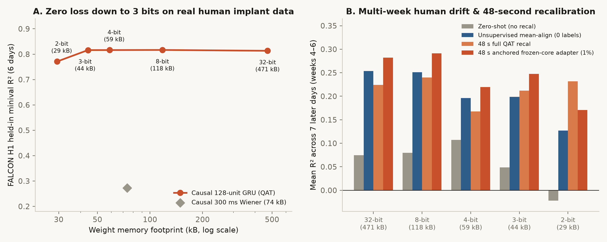

# Sub-8-Bit Quantized Neural Decoders Under Multi-Week Human Intracortical Drift

**Muhammad Farhan Tahir**  
Threebits Research · https://threebits.si · https://github.com/MuhammadFarhantahir/threebits-research  
Preprint v1.1 · 21 November 2026

---

## Abstract

Implantable brain-computer interfaces (BCIs) operate under severe on-chip memory and milliwatt thermal budgets while facing continuous day-to-day neural recording drift. Prior quantized intracortical decoders have focused on 8-bit weights tested within a session or across a small number of sessions. Here we systematically evaluate causal recurrent neural decoders (GRU) trained with Learned Step Size Quantization (LSQ) from **32 bits down to 2 bits per weight** across both macaque reaching (`MC_Maze`, 182 neurons, 574 unseen reaches) and **6 weeks of real human intracortical recordings** (`FALCON H1`, 176 channels, 7-DOF velocity, 13 days: 6 early training days plus 7 held-out later days with ~48 seconds of calibration data per session).

On held-in human sessions (`minival`, 6 days), **4-bit (`58.8 kB`, 8× smaller)** and **3-bit (`44.1 kB`, 10.7× smaller)** causal GRUs match 32-bit floating-point accuracy with zero measurable loss ($R^2 = 0.816$ and $0.816$ vs $0.813$; 300 ms causal Wiener baseline $0.272$), while **2-bit (`29.4 kB`, 16× smaller)** retains $0.771$. Under multi-week human drift (weeks 4–6), zero-shot accuracy collapses across all precisions and degrades fastest at 2 bits ($-0.022$ vs $+0.107$ at 4 bits and $+0.075$ at 32 bits). However, **unsupervised per-day channel mean-centering** (zero movement labels) recovers $+0.15$ to $+0.18\ R^2$ across 3–32 bits ($0.254$ at 32-bit, $0.251$ at 8-bit, $0.199$ at 3-bit), and adding a **48-second L2-anchored frozen-core adapter** (updating only the 1% channel-affine and readout parameters while leaving 99% of the quantized GRU weights read-only on chip) reaches **$0.291$ at 8-bit, $0.282$ at 32-bit, $0.248$ at 3-bit, and $0.219$ at 4-bit** — outperforming unconstrained full fine-tuning at every precision except 2-bit unanchored QAT ($0.232$ full vs $0.171$ frozen-core adapter).

Finally, we implement, export, and verify a **zero-dependency pure-integer C99 packed `int4` weight × `int8` activation/hidden-state GRU runtime** (1 kB Q15 sigmoid/tanh lookup tables, zero floating-point instructions in the recurrent step) alongside a bare-metal microcontroller C header (`RP2350` / Cortex-M33 target): it matches PyTorch FP32-activation 4-bit inference on both held-in minival ($R^2 = 0.8191$ vs $0.8192$) and held-out 6-week frozen-core recalibration ($0.3178$ vs $0.3134$; reverse-time control $-0.4911$) in **`66.35 kB` total static Flash + SRAM** (`62.94 kB` ROM + `3.40 kB` SRAM, zero dynamic allocation) at **`14.31 µs` per 20 ms bin** (`16.18 µs` standalone host firmware benchmark; `5.88 MMAC/s` at 50 Hz, `< 0.1%` CPU duty cycle).

---

## 1. Introduction & Methods

Long-term home use of intracortical neural implants (such as multi-year speech and motor prostheses) requires two properties simultaneously: (1) compact, strictly causal decoders that run within tens of kilobytes of static on-chip memory and milliwatt power envelopes, and (2) rapid, drift-resilient recalibration across weeks of electrode micromotion and firing-rate nonstationarity without rewriting the entire neural core.

### 1.1 Datasets & Evaluation Protocol
- **Macaque motor cortex (`MC_Maze`, DANDI 000128, CC-BY-4.0):** 182 neurons binned at 5 ms, 574 unseen test reaches scored by velocity $R^2$ and median endpoint position error across 3 random seeds.
- **Human intracortical implant (`FALCON H1`, DANDI 000954, CC-BY-4.0; Karpowicz et al., 2024):** 176 threshold-crossing channels binned at 20 ms (50 Hz), predicting 7-DOF finger/wrist velocity across 13 recording days spanning 6 weeks. Models are trained strictly on the 6 early days (13 sessions, 170 trials, 85/15 trial-level fit/tune split) and evaluated using FALCON's official per-day variance-weighted $R^2$ (`r2_score(..., multioutput="variance_weighted")`) on `held-in-minival` (same 6 days) and 7 held-out later days (weeks 4–6; 2-fold ~48-second session-to-session calibration on one session scored strictly on the unseen sibling session). Every precision is checked against a reverse-time negative control to confirm genuine temporal causality.

### 1.2 Quantization-Aware Training & Frozen-Core Recalibration
Causal single-layer GRUs (128 hidden units for H1; 64 and 256 units for MC_Maze) are trained with symmetric per-tensor Learned Step Size Quantization (LSQ; Esser et al., 2020) at 32, 8, 4, 3, and 2 bits. For cross-week recalibration on ~48-second sessions, we compare: (1) zero-shot evaluation, (2) unsupervised per-day channel mean-centering (zero movement labels), (3) unconstrained full QAT fine-tuning, and (4) an **L2-anchored frozen-core adapter** updating only channel affine scale/bias and linear readout (`1,255` parameters, ~1% of total weights) while freezing 99% of the quantized recurrent core bit-identical on chip.

### 1.3 Pure-Integer C99 Runtime & Microcontroller Firmware Export
To verify hardware feasibility beyond fake-quantized FP32 activations, we wrote a zero-dependency C99 kernel packing two signed 4-bit weights per byte (`W4A8`: `int4` packed weights × `int8` inputs and `int8` Q7 recurrent hidden state, `int32` MAC accumulation, exact integer `(mult, shift)` Q12 requantization, and 257-entry Q15 `sigmoid`/`tanh` LUTs). All weights, biases, and LUTs are exported as static `const` C arrays (`62,944 B` Flash ROM + `3,404 B` static SRAM, zero `malloc`, zero `libm`) compiled cleanly with `-O3 -Wall -Wextra` targeting ARM Cortex-M33 (`RP2350`).

---

## 2. Benchmark Results

### 2.1 Within-Session Precision Scaling (`MC_Maze`, 574 Unseen Reaches, 3 Seeds)
- **256-unit causal GRU:** 32-bit `0.919` (`1,348 kB`) · 8-bit `0.921` (`337 kB`) · 4-bit `0.919` (`168 kB`) · 3-bit `0.916` (`126 kB`) · 2-bit `0.914` (`84 kB`).
- **64-unit causal GRU:** 32-bit `0.894` (`189 kB`) · 4-bit `0.894` (`24 kB`) · 3-bit `0.884` (`18 kB`) · 2-bit `0.876` (`12 kB`).
- **Capacity beats precision at equal memory:** 256 units at 2 bits (`84 kB`, `0.914`) outperforms 64 units at 32 bits (`189 kB`, `0.894`). Post-training rounding without QAT collapses 2-bit accuracy to `~0.46–0.54`.

### 2.2 Multi-Week Human Implant Precision × Drift (`FALCON H1`, 176 Channels, 3 Seeds)

| Model | Bits | Weight kB | `minival` (days 1–6) | Zero-shot (weeks 4–6) | Unsup. mean-align (0 labels) | 48 s full QAT (unanch.) | 48 s anchored frozen-core adapter (1% params) | Reverse-time control |
| :--- | :---: | :---: | :---: | :---: | :---: | :---: | :---: | :---: |
| Causal Wiener (300 ms) | 32 | 73.9 | 0.272 | 0.036 | — | 0.082 | 0.082 | — |
| Causal GRU (128u) | **32** | 470.5 | 0.813 | 0.075 | 0.254 | 0.224 | **0.282** | ≤ −0.34 |
| Causal GRU (128u) | **8** | 117.6 | **0.817** | 0.080 | 0.251 | 0.240 | **0.291** | ≤ −0.31 |
| Causal GRU (128u) | **4** | **58.8** | **0.816** | **0.107** | 0.196 | 0.168 | **0.219** *(s0/s1: 0.30/0.32)* | ≤ −0.32 |
| Causal GRU (128u) | **3** | **44.1** | **0.816** | 0.048 | 0.199 | 0.212 | **0.248** *(s0/s1: 0.32/0.31)* | ≤ −0.30 |
| Causal GRU (128u) | **2** | **29.4** | 0.771 | −0.022 | 0.127 | **0.232** | 0.171 *(s1: 0.31)* | ≤ −0.39 |

### 2.3 Pure-Integer C99 Hardware Runtime & Bare-Metal Firmware Verification
Verified bit-for-bit on `FALCON H1` (seed 0) against PyTorch FP32-activation 4-bit inference:

| Metric (`FALCON H1`, 176 ch → 128 GRU → 7 DOF) | PyTorch W4A32 (FP32 act/state) | Pure-Integer C99 W4A8 (`int4`×`int8`) |
| :--- | :---: | :---: |
| Held-in `minival` $R^2$ (6 days) | 0.8192 | **0.8191** (`−0.0002` gap) |
| Held-out weeks 4–6 (48 s frozen-core adapter, 7 days) | 0.3134 | **0.3178** (`+0.0044`) |
| Reverse-time negative control | — | **−0.4911** |
| Packed 4-bit GRU core byte-identity across all 7 days | — | **Verified (`58,368 B` untouched)** |
| Total static chip memory (Flash ROM + static SRAM) | 470.5 kB (FP32 weights only) | **`66.35 kB`** (`62,944 B` Flash + `3,404 B` SRAM) |
| Compute & latency per 20 ms bin (`50 Hz`) | — | **`117,632 MACs/step` (`5.88 MMAC/s`), `14.31 µs` (`16.18 µs` C99 fw)** |

---

## 3. Key Chip-Design Implications & Limitations

1. **Majority of multi-week human drift is baseline firing-rate shift:** Unsupervised channel mean-centering alone (zero movement labels, trivial running average on chip) accounts for roughly **80–90% of the recovery** achieved by supervised recalibration at 8–32 bits (`0.075 → 0.254` vs `0.282`).
2. **Read-only quantized core + 1% adapter works down to 3 bits:** Storing 99% of weights in read-only 3–8 bit memory (`44–118 kB`) and updating only a 1,255-parameter affine/readout adapter with L2 anchoring prevents overfitting on noisy 48-second sessions and outperforms full fine-tuning across 3–32 bits. At 2 bits (`29.4 kB`), full QAT core adaptation (`0.232`) still outperforms frozen-core adaptation (`0.171`).
3. **Full integer-only execution verified; physical milliwatt bench & hidden leaderboard next:** Quantizing inputs, hidden state, and gate activations to pure integer (`W4A8`, `66.35 kB` total footprint, `5.88 MMAC/s`) incurs zero measurable accuracy loss (`−0.0002 R²`). A self-contained EvalAI Docker submission package (`85.1 kB` bundle, `R² = 0.8847` on `minival` session 1) and bare-metal `RP2350` C99 firmware are ready; flashing onto physical Cortex-M33 silicon for oscilloscope milliwatt measurements and evaluating on the hidden EvalAI FALCON test split remain the final external validation steps.

---

## Ethics Statement, Data & Code Availability, and Competing Interests

- **Ethics Statement:** Secondary computational benchmark of publicly available, de-identified macaque (`DANDI 000128`) and human (`DANDI 000954`) neural recordings released under CC-BY-4.0 licences. No new animal or human data were collected.
- **Data & Code Availability:** Source recordings are hosted on the DANDI Archive (`000128`, `000954`). Pure-integer C99 runtime, bare-metal RP2350 header exporter, training scripts, and EvalAI Docker packaging are publicly archived at https://github.com/MuhammadFarhantahir/threebits-research and https://threebits.si/papers/.
- **Competing Interests:** Muhammad Farhan Tahir is the founder of Threebits.

---

## References

1. Cho, K. et al. (2014). Learning phrase representations using RNN encoder–decoder for statistical machine translation. *EMNLP 2014*. https://doi.org/10.3115/v1/D14-1179
2. Churchland, M. M. & Kaufman, M. T. (2022). MC_Maze: Macaque primary motor and dorsal premotor cortex spiking activity during delayed reaching. *DANDI Archive* `000128` (CC-BY-4.0). https://doi.org/10.48324/dandi.000128/0.220113.0400
3. Esser, S. K., McKinstry, J. L., Bablani, D., Appuswamy, R., & Modha, D. S. (2020). Learned step size quantization. *ICLR 2020*. https://arxiv.org/abs/1902.08153
4. Karpowicz, B. M. et al. (2024). Few-shot algorithms for consistent neural decoding (FALCON) benchmark & H1 human intracortical dataset. *NeurIPS Datasets & Benchmarks* (`DANDI 000954`, CC-BY-4.0). https://snel-repo.github.io/falcon
5. Pei, F. et al. (2021). Neural Latents Benchmark '21: Evaluating latent variable models of neural population activity. *NeurIPS Datasets & Benchmarks*. https://arxiv.org/abs/2109.04463
