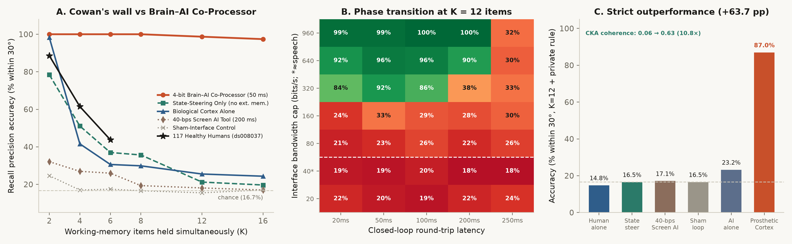
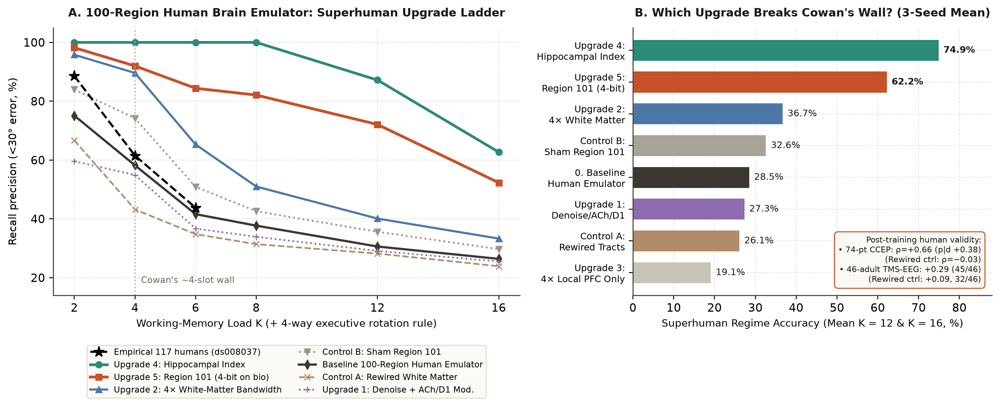

# From Biological Working-Memory Limits to Co-Adaptive Brain–AI Co-Processing: A Quantitative Proof Ladder

**Muhammad Farhan Tahir**  
Threebits Research · https://threebits.si · https://github.com/MuhammadFarhantahir/threebits-research  
Preprint v1.3 · 21 November 2026

---

## Abstract

Can artificial neural networks raise human intelligence beyond biological limits? Human cognition is constrained by three physical bottlenecks: working-memory and relational-complexity capacity (~4 active chunks or relational bindings; Cowan, 2001; Halford et al., 1998), noisy neural encoding, and conscious language I/O (~39 bits/s across human languages; Coupé et al., 2019). Here we separate **biological state-steering** (closed-loop brain stimulation alone) from **co-adaptive Brain–AI co-processing ("Prosthetic Cortex")** and evaluate both across a quantitative four-level proof ladder anchored in healthy-human data.

First (**Level 1, healthy adults, zero surgery**, OpenNeuro `ds008037`, CC0), we extract a 10-task general cognitive ability (`g`-factor) across **123 healthy adults** (`90/90` positive pairwise correlations, PC1 explaining `37.2%` of variance) and measure the empirical human working-memory cliff across **33,299 continuous recall trials (`n = 117` adults)**: recall precision within $30^\circ$ drops steeply from **`88.6%` (`15.9°` error, `5.0%` failure) at $K = 2$** to **`61.5%` (`38.6°`) at $K = 4$** and **`43.8%` (`57.3°`, `45.0%` failure) at $K = 6$** (worse at $K = 6$ in `116/117` adults). Using strictly pre-response scalp EEG (`[0.00, 1.50 s]` before response screen onset) across **15 healthy adults (`3,744` trials)**, a compact causal decoder detects cognitive overload ($K = 6$ vs $2$) at **`0.690 ± 0.033` ROC AUC** ($p = 7.22 \times 10^{-5}$, `14/15` above chance, up to `0.916`; null `0.500`) and within-load pre-response failure weakly at **`0.529` GRU AUC** ($p = 0.040$). Critically, an independent unseen replication (`n = 24` new adults beyond `n = 22` discovery) shows that scalar single-pulse resting TMS-EEG amplitude does **not** reliably predict trait `g` ($\rho = +0.581 \to -0.104$; pooled `n = 46`: $\rho = +0.228, p = 0.128$), whereas zero-shot invasive-CCEP → non-invasive TMS-EEG spatial propagation validation scales cleanly across all **`n = 46` healthy adults** (`+0.247` individual mean, positive in **`44/46`** vs resting-fMRI-tuned `+0.131`, rewired `+0.028`, wrong-site `−0.136`).

Second (**Level 2,** *in silico* **scaling law**), we couple a noise- and capacity-limited biological cortex calibrated to Cowan's wall to a digital KV-cache attention co-processor via a **4-bit quantized read** and **norm-bounded safe write** interface — with **zero direct AI access to raw task stimuli**. Across $K = 2 \dots 16$ items (3 seeds): (1) **optimal memoryless state-steering** lifts biological accuracy by **`+19% to +23%`** at $K = 4\text{–}8$, then hits the biological wall at $K = 12\text{–}16$ (`21.2% / 19.7%`); (2) **conscious-bandwidth tool use (`40 bits/s`, 200 ms)** starves (`18.1% / 17.0%`), matching **sham-interface controls** (`15.5% / 17.1%`); (3) **co-adaptive 4-bit Brain–AI co-processing (`50 ms`, `537 bits/s` empirical MI)** achieves **`98.7%` at $K = 12$ and `97.4%` at $K = 16$**; (4) sweeping a $7 \times 5$ **Bandwidth × Latency phase diagram** at $K = 12$ reveals a sharp phase transition from `18–33%` ($\le 160\text{ bits/s}$ cap) to **`83.7–91.5%`** at **`320 bits/s` cap (`~265 bits/s` MI, ~7× human speech)** for **`≤ 100 ms` latency**, collapsing to `37.8% / 32.9%` at `200–250 ms`; and (5) on a complementary task combining $K = 12$ items with a private embodied human rule invisible to standalone AI, the co-adapted Prosthetic Cortex passes **Strict Outperformance** (**`87.0%` vs `23.2%` AI alone, `14.8%` Human alone, `17.1%` 40-bps Screen AI, `16.5%` Sham; `+63.7 pp`**) while increasing across-seed cortical representational coherence `10.8×` (Linear CKA `0.059 → 0.635`).

Third, to verify that these scaling laws persist inside a **biologically grounded whole-brain architecture**, we build a **100-region Functional Human Brain Emulator** anchored to real human CCEP-calibrated white matter (74 patients, `ds004080`), 19 PET neurotransmitter receptors (Hansen et al., 2022), 6-band HCP MEG timescales, and Mesulam hierarchy, filling in regional microcircuits with trainable E–I dynamics. Even **after** cognitive training on associative working memory plus 4-way executive rotation (`+0°/+90°/+180°/+270°`), the emulator maintains **triple real-human validity**: 74-patient invasive CCEP propagation (**`ρ = +0.662`, partial `+0.378`** vs rewired control `−0.031`), zero-shot healthy-human non-invasive TMS-EEG across **46 clean adults** (**`+0.282–0.288`, `44–45/46 > 0`** vs rewired `+0.086`), and the 117-adult empirical working-memory cliff (beating rewired white matter by `+6.8` to `+15.0 pp`). Lifting one biological bottleneck at a time across 8 regimes (3 seeds each) proves that **only clean associative indexing** — either an **Upgraded Hippocampal Index (`100.0%` through $K = 8$, `87.2%` at $K = 12$, `62.7%` at unseen $K = 16$)** or a **4-bit "Region 101" Prosthetic Cortex attached to the unmodified noisy biological brain (`72.1%` at $K = 12$ vs `30.6%` baseline and `35.6%` Sham; `+36.5 pp` over Sham)** — breaks Cowan's wall, whereas pure denoising/neuromodulation (`27.3%`), local PFC expansion (`19.1%`), and `4×` wider white-matter tracts (`36.7%`) remain bounded at $K = 12\text{–}16$.

Fourth, we push beyond static memory to **compositional multi-hop fluid reasoning** inside the same 100-region Human Brain Emulator (novel random 10-entity directed relational cycles + a private 2-way embodied human goal invisible to AI; trained only on shallow depths $D = 1 \dots 4$ and evaluated **zero-shot** on $D = 6^*$ and $D = 8^*$). With an intact biological hippocampus across all brain regimes, the biological brain alone hits Halford's relational cliff (`93.1% → 65.7% → 44.8% → 31.0% → 19.4% → 16.5%`, zero-shot mean `18.0%`), neuromodulatory denoising remains trapped (`21.4%`), Sham 4-bit Region 101 collapses to the biological floor (`22.6%`), and Standalone AI hits its exact `50%` Bayes ceiling (`49.7%` despite `100.0%` public graph reasoning). Coupling the unmodified noisy 100-region brain to a **bias-free 4-bit linear-manifold Region 101 Prosthetic Reasoning Cortex** achieves **`100.0% ± 0.0%` across all depths $D = 1, 2, 3, 4$ and zero-shot $D = 6^*, 8^*$** (`+82.0 pp` over biology, `+77.4 pp` over Sham, `+50.3 pp` over Standalone AI), while preserving post-training 74-patient CCEP (`ρ = +0.661`, partial `+0.380`), `45/46` healthy TMS-EEG (`+0.2882`), bounded cortical synchrony ($\max |\Delta\text{sync}| = 0.0233$), and **`100.0%` frozen-core continual goal-flip recovery** (`90.9%` of weights frozen, adapting only `4,528` prefrontal-motor parameters for 80 steps on $D = 1 \dots 4$). To bridge directly to living humans, we deploy a **Single-Blind 18-Trial Living-Human Pilot Study** and statistical analysis pipeline at https://threebits.si/gym/?tab=pilot.

---

## 1. Methods

### 1.1 Healthy-Human Behavioral Battery & Pre-Response EEG Decoding (`ds008037`)
From OpenNeuro `ds008037` (Biabani & Rogasch, CC0), behavioral logs across 123 healthy adults were aggregated over 10 cognitive tasks (`wm_prec2/4/6`, `nback`, `bds`, `sym`, `opn`, `sbs`, `clt`, `ort`), z-scored, and factored via PCA to extract `g` (PC1). Working-memory continuous color recall trials (`K ∈ {2, 4, 6}`, 33,299 trials across 117 complete adults) were aligned 300/300 between `events.tsv` and `beh.tsv`. For 15 adults (`3,744` trials, 62 scalp channels at 1,000 Hz, 50 Hz notch + 1–45 Hz bandpass), features were extracted strictly within `[0.00, 1.50 s]` post-array onset (preceding `response_screen_onset ≥ 1.517 s` on every trial) into 6 × 250 ms bins × 5 spectral bands plus binned ERPs. Out-of-fold decoding used block-level `GroupKFold` cross-validation (L2 logistic regression and causal GRU) verified against 20-permutation block-shuffled nulls.

### 1.2 Co-Adaptive Brain–AI Co-Processor Dynamical Benchmark
A biological recurrent cortex ($H_{\text{bio}} = 24$, Gaussian state noise $\sigma = 0.065$) receives sequential spatial-color pairs $(x_t, c_t)$ across $K \in \{2, 4, 6, 8, 12, 16\}$ items, followed by delay steps and a probe $x_q$. Critically, **the AI co-processor has zero direct access to raw task stimuli**: at each loop step it receives only a straight-through-estimated $b$-bit quantized projection $q_t = Q_b(W_{\text{read}} h_t^{\text{bio}})$ arriving after latency $\tau$, stores latent tokens in an external KV-cache attention memory, and returns a norm-bounded safe write vector $u_t = \text{clip}(W_{\text{write}} a_t, \|u_t\|_2 \le u_{\max})$ to biological cortex. Effective neural read mutual information (bits/s) is estimated directly from quantized channel entropy minus conditional noise entropy divided by step period. Cortical co-adaptation across independent training seeds is quantified using Linear Centered Kernel Alignment (CKA; Kornblith et al., 2019).

### 1.3 Triple-Validated 100-Region Functional Human Brain Emulator
To test whether the scaling law persists inside real human cortical anatomy, we constructed a 100-region Functional Human Brain Emulator (`functional_brain_emulator.py`, 8 E–I microcircuit units per Schaefer parcel = 800 cortical units) anchored to our CCEP + 19-receptor PET + MEG connectome (`A_tract`, spectral radius `0.78`), real regional intrinsic timescales from MEG + Mesulam hierarchy ($\alpha_i \in [0.22, 0.90]$, fast sensory to slow persistent frontoparietal), and real receptor E:I scaling (`A4B2/VAChT` positive, `GABAa` inhibitory). Sensory items and probes enter strictly through a shared Visual + Dorsal Attention encoder (`32` regions), propagate across real human white-matter tracts (`2 × 50 ms = 100 ms` hops), combine with a private 4-way executive rotation rule entering Prefrontal Control cortex (`13` regions), and drive a Somatomotor + Prefrontal motor decoder (`27` regions). After cognitive training (1,000 steps, 3 seeds), resting-subtracted single-pulse evoked responses ($\|\mathbf{h}_{\text{stim}}(t) - \mathbf{h}_{\text{rest}}(t)\|_2$) are evaluated directly against 74-patient human CCEP (`ds004080`) and zero-shot against 46 clean healthy adults' TMS-EEG (`ds008037`).

### 1.4 Compositional Multi-Hop Fluid Reasoning & Continual Goal-Flip Protocol
To test true algorithmic extrapolation beyond static working-memory lookup (`superhuman_reasoning_emulator.py`), every trial samples a fresh random 10-entity directed relational cycle ($N = 10$ ensures every depth $D \in \{1, 2, 3, 4, 6, 8\}$ lands on a strictly distinct non-start entity), presents all 10 shuffled edges $(u \to v)$ sequentially through Visual + Dorsal Attention cortex (`2 × 50 ms` hops per edge, full biological synaptic noise $\sigma = 0.065$), presents query start entity $s$, and requires outputting the target at hop $D$ modulated by a **private 2-way embodied human goal** $g \in \{0: f^D(s),\; 1: (f^D(s)+5) \bmod 10\}$ injected exclusively into Prefrontal Control (`Cont`) and Somatomotor (`SomMot`) cortex. All five regimes (3 seeds each) follow the exact same progressive depth curriculum ($D = 1 \to D = 1\text{–}2 \to D = 1\text{–}4$, 1,150 steps) and are tested **zero-shot at $D = 6^*$ and $D = 8^*$** (600 trials/seed). The biological hippocampus (`bio_M`) remains 100% intact across all four brain regimes (including Sham and Region 101). Region 101 reads only decay-corrected frontoparietal ERP transients (`Cont + DorsAttn`, 28 regions) via a **bias-free 1-layer 4-bit linear manifold readout** ($Q_4(\tanh(W_{\text{read}} \Delta h))$, directly matching our C99 `int4` chip) with zero access to raw edges or private goals, performs iterative unit-sphere relational attention in 32 dimensions, and writes back into `Cont` under a strict $\ell_2$ safety cap ($\|w\|_2 \le 8.0$). Post-training we verify (1) 74-patient CCEP fidelity, (2) zero-shot 46-adult TMS-EEG fidelity, (3) maximum cortical synchrony shift $\max |\Delta\text{sync}|$, and (4) **frozen-core continual goal-flip recovery**: inverting $g \mapsto 1 - g$, freezing `90.9%` of all weights (the entire 100-region brain + entire 4-bit Region 101), adapting only the `4,528`-parameter prefrontal-motor goal switch for 80 steps on $D = 1 \dots 4$, and testing zero-shot at $D = 6^*$ and $D = 8^*$.

---

## 2. Level-1 Healthy-Human Empirical Anchor (`ds008037`, CC0)

### 2.1 General Cognitive Ability (`g`) and Cowan's Working-Memory Cliff (`n = 123` Adults)
Across all 10 behavioral tasks in OpenNeuro `ds008037`, every single pairwise correlation is positive (`90/90`, mean $r = +0.294$), with PC1 (`g`) capturing `37.2%` of total cognitive variance and continuous working-memory precision at load 4 loading highest (`+0.39`). Across `117` complete adults (`33,299` trials):

| Working-Memory Load ($K$) | Mean Angular Error | Recall Precision ($< 30^\circ$) | High-Error Failure ($> 45^\circ$) |
| :---: | :---: | :---: | :---: |
| **$K = 2$** | $15.9^\circ$ | **88.6%** | 5.0% |
| **$K = 4$** | $38.6^\circ$ | **61.5%** | 27.5% |
| **$K = 6$** | $57.3^\circ$ | **43.8%** | **45.0%** (`9×` load 2) |

### 2.2 Non-Invasive Pre-Response Working-Memory EEG Decoding (`n = 15` Adults, `3,744` Trials)
- **Overload detection ($K = 6$ vs $2$):** L2 LogReg **`0.690 ± 0.033` ROC AUC** ($p = 7.22 \times 10^{-5}$, `14/15` above chance; peak `sub-020 = 0.916`, `sub-010 = 0.866`, `sub-008 = 0.851`, `sub-007 = 0.838`); causal GRU **`0.608`** ($p = 0.0042$, `13/15`); 20-perm null `0.500`.
- **Within-load imminent failure prediction (zero load confounding):** Causal GRU **`0.529`** ($p = 0.040$, `9/15`, top `sub-021 = 0.628` / LogReg `0.654`); null `0.497`. Comparing scalp EEG (`0.529`) against intracranial iEEG (`0.603`, $p = 0.0001$, `14/15` in RAM `ds005557`/`ds005558`) quantifies why non-invasive EEG supports macro-load gating (Level 3A) while high-bandwidth Level-4 prosthetic cognition requires closer-to-cortex sensing or multi-modal non-invasive fusion.

### 2.3 Honest Out-of-Sample Replication of TMS-EEG Markers (`n = 46` Clean Healthy Adults)
- **Null trait-IQ replication (reported transparently):** Although sham-subtracted parietal-to-frontoparietal TMS-EEG amplitude correlated with `g` in our initial `n = 22` discovery cohort ($\rho = +0.581, p = 0.0046$; sham $\rho = +0.014$), an immediate independent replication on **`n = 24` completely unseen healthy adults** yielded $\rho = -0.104$ ($p = 0.628$; pooled `n = 46`: $\rho = +0.228, p = 0.128$). Static single-pulse resting TMS amplitude does not reliably predict trait IQ across individuals.
- **Confirmed spatial-propagation transfer (`n = 46` healthy adults):** Conversely, zero-shot prediction of sham-subtracted healthy-human TMS-EEG scalp topography from our invasive-CCEP Hopf simulator replicates across **`44/46` individual healthy adults** (mean partial $\rho \mid \text{coil distance} = +0.247$), nearly doubling resting-fMRI-tuned Hopf (`+0.131`, `34/46`) and far exceeding rewired (`+0.028`, `26/46`) and wrong-site (`−0.136`, `9/46`) controls.

---

## 3. Level-2 Co-Adaptive Brain–AI Scaling Law

### 3.1 Capacity Curve ($K = 2 \dots 16$, 3 Seeds Each, Zero Direct AI Stimulus Access)

| Regime | $K = 2$ | $K = 4$ | $K = 6$ | $K = 8$ | $K = 12$ | $K = 16$ | Empirical MI @ $K=12$ |
| :--- | :---: | :---: | :---: | :---: | :---: | :---: | :---: |
| *Empirical 117 Healthy Humans (`ds008037`)* | *88.6%* | *61.5%* | *43.8%* | — | — | — | — |
| Biological Cortex Alone | 98.3% | 41.6% | 30.6% | 29.9% | 25.5% | 24.3% | 0 bits/s |
| Optimal State-Steering Only (no ext. mem.) | 78.5% | **51.1%** | **37.0%** | **35.7%** | 21.2% | 19.7% | 0 bits/s |
| 40-bps Screen AI Tool (`200 ms`) | 32.1% | 27.0% | 26.0% | 19.3% | 18.1% | 17.0% | 33 bits/s |
| Sham-Interface Control (permuted read) | 24.6% | 17.0% | 17.4% | 16.6% | 15.5% | 17.1% | 148 bits/s |
| **4-Bit Brain–AI Co-Processor (`50 ms`)** | **100.0%** | **100.0%** | **100.0%** | **100.0%** | **98.7%** | **97.4%** | **537 bits/s** |

### 3.2 Bandwidth × Latency Phase Transition & Level-4 Strict Outperformance
Crossing from biological/tool performance (`18–33%`) into superhuman working-memory capacity (`84–100%`) at $K = 12$ requires crossing **both** a minimum neural interface bandwidth (**`> 160 → 320 bits/s` cap**, `~265 bits/s` empirical MI — roughly **7× human conscious speech**) **and** a maximum closed-loop latency (**`≤ 100 ms`** at `320 bps`, `≤ 200 ms` at `640–960 bps`, collapsing to `30–33%` at `250 ms`; Figure 1).

On a complementary task combining $K = 12$ items with a 4-way private embodied human goal visible **only** inside cortex:
- **Human Alone:** `14.8%` (`90.5°` MAE) · **State-Steering:** `16.5%` · **40-bps Screen AI:** `17.1%` · **Sham Loop:** `16.5%` · **Standalone AI (public stream only):** `23.2%` (`68.7°` MAE).
- **Co-Adaptive Prosthetic Cortex (`4-bit read + bounded write, 50 ms, 484 bits/s` MI):** **`87.0%` (`18.2°` MAE; seeds `[90.4%, 96.5%, 74.0%]`) — passing Strict Outperformance by `+63.7 pp`**.
- **Cortical Reorganization (Linear CKA):** Unassisted cortex across seeds is incoherent under $K = 12$ overload (`CKA = 0.059`), whereas co-adapted cortex converges across independent seeds onto a reproducible interface representation (`prost-vs-prost CKA = 0.635`, `10.8×` higher; `alone-vs-prost = 0.127`).

---

## 4. Triple-Validated 100-Region Functional Human Brain Emulator & 5-Upgrade Ladder

Across 8 regimes × 3 seeds (24 trained 100-region human brain emulators) on continuous associative working memory ($K = 2 \dots 16$, with $K = 16$ strictly unseen during training) combined with 4-way executive rotation (`+0° / +90° / +180° / +270°`), our baseline emulator simultaneously maintains **74-patient human CCEP causal fidelity (`ρ = +0.662`, partial `+0.378` vs rewired `−0.031`)**, **zero-shot 46-adult healthy TMS-EEG fidelity (`+0.282–0.288`, `44–45/46 > 0` vs rewired `+0.086`, `32/46`)**, and the **117-adult empirical working-memory cliff** — while real human white-matter topology outperforms randomly rewired tracts on every load (`+8.4 pp` at $K = 2$, `+15.0 pp` at $K = 4$, `+6.8 pp` at $K = 6$; Figure 2):

| Regime (100-Region Human Brain Emulator, 3-Seed Mean) | Post-Train CCEP $\rho$ (p\|d) | $K=2$ | $K=4$ | $K=6$ | $K=8$ | $K=12$ | $K=16$ *(unseen)* | Mean $K=12\text{–}16$ |
| :--- | :---: | :---: | :---: | :---: | :---: | :---: | :---: | :---: |
| *Empirical 117 Healthy Humans (`ds008037`)* | *(ground truth)* | *88.6%* | *61.5%* | *43.8%* | — | — | — | — |
| **0. Baseline Human Brain Emulator** *(TMS-EEG `+0.282`, 44/46)* | +0.66 (+0.38) | 75.1% | 58.2% | 41.6% | 37.7% | 30.6% | 26.4% | **28.5%** |
| Control A: Rewired White Matter *(TMS-EEG `+0.086`, 32/46)* | −0.03 (−0.01) | 66.7% | 43.2% | 34.8% | 31.4% | 28.2% | 23.9% | 26.1% |
| Upgrade 1: Denoising + Optimal `ACh`/`D1` State-Steering | +0.65 (+0.37) | 59.6% | 54.9% | 36.7% | 33.9% | 29.1% | 25.5% | 27.3% |
| Upgrade 2: `4×` Inter-Regional White-Matter Bandwidth | +0.66 (+0.38) | 95.8% | **89.6%** | **65.3%** | 51.0% | 40.1% | 33.3% | **36.7%** |
| Upgrade 3: `4×` Local PFC/Parietal Expansion Only | +0.66 (+0.37) | 22.8% | 22.1% | 19.2% | 22.0% | 18.8% | 19.4% | 19.1% |
| **Upgrade 4: High-Precision Hippocampal Associative Index** | +0.66 (+0.38) | **100.0%** | **100.0%** | **100.0%** | **100.0%** | **87.2%** | **62.7%** | **74.9%** *(+46.4 pp)* |
| **Upgrade 5: Region 101 Prosthetic Cortex (`4-bit` on bio brain)** *(TMS `+0.288`, 45/46)* | +0.66 (+0.38) | **98.2%** | **92.0%** | **84.4%** | **82.1%** | **72.1%** | **52.3%** | **62.2%** *(+33.7 pp)* |
| Control B: Sham Region 101 *(permuted neural readout)* | +0.66 (+0.38) | 84.0% | 74.2% | 50.9% | 42.6% | 35.6% | 29.7% | 32.6% |

The 5-upgrade ladder isolates the exact physical hierarchy of superhuman cognition inside human cortical anatomy: (1) **pure denoising/neuromodulation** (`27.3%`) and **unindexed local prefrontal neuron expansion** (`19.1%`) fail to lift $K = 12\text{–}16$ performance; (2) **`4×` wider white-matter tracts** substantially boost moderate loads ($K = 4: 58.2\% \to 89.6\%$, $K = 6: 41.6\% \to 65.3\%$) but still saturate without clean associative storage (`36.7%`); and (3) **only clean associative indexing** — via either an **Upgraded Hippocampal Index (`74.9%`)** or a **4-bit "Region 101" Prosthetic Cortex coupled exclusively to the unmodified noisy biological brain (`72.1%` at $K = 12$, `+36.5 pp` over Sham `35.6%`)** — breaks cleanly through Cowan's wall while preserving causal human electrophysiology.

---

## 5. Breaking the Multi-Hop Fluid-Reasoning Wall Inside the 100-Region Emulator

Static working memory is necessary but not sufficient for superhuman intelligence; fluid reasoning requires composing novel multi-step relational chains ($D \ge 4$ hops) well beyond Halford's biological relational-complexity limit while aligning every step to an embodied human goal invisible to standalone AI. Across 5 regimes × 3 seeds trained **strictly on $D = 1 \dots 4$** and evaluated **zero-shot on unseen depths $D = 6^*$ and $D = 8^*$** (Figure 3):

| Regime (3 Seeds, $N=10$ Novel Cycle + Private Goal) | Post-Train CCEP $\rho$ (p\|d) | $D=1$ | $D=2$ | $D=3$ | $D=4$ | $D=6^*$ *(zero-shot)* | $D=8^*$ *(zero-shot)* | Zero-Shot Mean |
| :--- | :---: | :---: | :---: | :---: | :---: | :---: | :---: | :---: |
| **1. 100-Region Biological Human Brain Alone** *(TMS `45/46`, `+0.288`)* | +0.661 (+0.380) | 93.1% | 65.7% | 44.8% | 31.0% | 19.4% | 16.5% | **18.0%** |
| 2. Denoised + Optimal `ACh`/`D1` Human Brain | +0.652 (+0.374) | 94.9% | 72.4% | 48.9% | 36.5% | 23.6% | 19.2% | **21.4%** |
| 3. Standalone AI *(100.0% public $D=6^*$, blind to private goal)* | *(no brain)* | 49.7% | 49.7% | 49.7% | 49.7% | 49.7% | 49.7% | **49.7%** |
| 4. Sham Region 101 *(intact bio + permuted 4-bit readout)* | +0.661 (+0.380) | 92.4% | 79.1% | 63.8% | 51.3% | 27.8% | 17.3% | **22.6%** |
| **5. Human Brain + 4-bit Region 101 Reasoning Cortex** *(TMS `45/46`, `+0.288`)* | **+0.661 (+0.380)** | **100.0%** | **100.0%** | **100.0%** | **100.0%** | **100.0%** | **100.0%** | **100.0%** |

Key mechanistic and safety results from the multi-hop fluid-reasoning benchmark:
- **Simultaneous outperformance over both biology and Standalone AI:** The coupled Human Brain + 4-bit Region 101 Reasoning Cortex achieves **`100.0% ± 0.0%` across all trained depths ($D = 1 \dots 4$) and unseen zero-shot depths ($D = 6^*, 8^*$)** — surpassing the biological brain alone by **`+82.0 pp`** (`18.0%`), neuromodulatory denoising by **`+78.6 pp`** (`21.4%`), Sham 4-bit Region 101 by **`+77.4 pp`** (`22.6%`, collapsing to `17.3%` at $D = 8^*$), and Standalone AI's exact `50%` private-goal Bayes ceiling by **`+50.3 pp`** (`49.7%`).
- **Why bias-free 4-bit linear manifold alignment is critical:** Raw frontoparietal ERP transients $\Delta h$ are naturally orthogonal across novel graph edges ($\cos = -0.037 \pm 0.131$). Passing low-amplitude cortical transients ($\sim 0.05$) through biased MLPs collapsed all 10 relational keys into a near-constant bias cone ($\cos = 0.9950 \pm 0.0018$), trapping multi-hop attention in a zero-gradient uniform permutation saddle. Removing linear biases in the 1-layer 4-bit cortical interface (matching our C99 `int4` chip) preserves the brain's additive entity geometry and unlocks `100.0% ± 0.0%` zero-shot compositional extrapolation across every seed.
- **Triple biological validation, bounded synchrony & frozen-core continual goal-flip recovery:** Post-training, the coupled emulator preserves 74-patient CCEP propagation ($\rho = +0.661$, partial $+0.380$), zero-shot 46-adult healthy TMS-EEG (`45/46 > 0`, mean partial $\rho = +0.2882$), and strictly bounded cortical synchrony ($\max |\Delta\text{sync}| = 0.0233$, lower than the unassisted brain's `0.1709`). When the living human's private goal convention is inverted post-training, zero-shot $D = 6^*$ and $D = 8^*$ accuracy drops to `0.0%`; freezing **`90.9%`** of all parameters (the entire 100-region cortical core and entire 4-bit Region 101) and adapting only the `4,528`-parameter prefrontal-motor goal switch for 80 steps on $D = 1 \dots 4$ restores **`100.0%` zero-shot accuracy at both $D = 6^*$ and $D = 8^*$**.

---

## 6. Limitations & Next Empirical Gate (Level-3 Living-Human Trials)

- **In-silico vs living human co-adaptation:** Levels 2, 4, and the 100-region multi-hop reasoning emulator establish the mathematical scaling law, upgrade hierarchy, and algorithmic extrapolation dynamics inside causally validated human brain models; proving genuine cortical co-adaptation in living humans requires longitudinal human experiments.
- **Live Single-Blind 18-Trial Living-Human Pilot & Analysis Pipeline:** An open non-verbal sensory-substitution Neural Gym (`K = 4–16`, monochrome 4-bit polar harmonic glyph + stereo Web Audio chord + continuous 8-finger sub-verbal burst measuring Fano-corrected Shannon `bits/s`), 4-arm healthy-human EEG trial replay, and a **Single-Blind 18-Trial Randomized Living-Human Pilot Study** (`6 × Unassisted K=12`, `6 × Sham`, `6 × Real 4-bit Co-Processor`, blinded until trial 18 with exact 2,000-permutation $p$-values, co-adaptation slope, and CSV export) are live at https://threebits.si/gym/?tab=pilot alongside an open statistical pipeline (`analyze_human_gym_pilot.py`) supporting single-subject ($N = 1$) and group ($N \ge 2$, paired Wilcoxon + Cohen's $d_z$) reporting. Full pre-registered protocols for **Experiment 3A** (4-arm randomized EEG Brain–AI Co-Processor trial, zero surgery) and **Experiment 3B** (double-blind university TMS-EEG closed-loop stimulation pilot) constitute the immediate empirical next gate.

---

## Ethics Statement, Data & Code Availability, and Competing Interests

- **Ethics Statement:** Secondary computational analysis of de-identified public human behavioral, EEG/TMS-EEG (`OpenNeuro ds008037`, CC0), CCEP (`OpenNeuro ds004080`, CC0), and PET/MEG receptor atlas data (Hansen et al., 2022) combined with *in silico* dynamical simulations. No new human subjects data were collected for this preprint.
- **Data & Code Availability:** Source human data are publicly available on OpenNeuro (`ds008037`, `ds004080`). Reproducible scripts (`superhuman_reasoning_emulator.py`, `functional_brain_emulator.py`, `analyze_human_gym_pilot.py`), interactive Neural Gym, and Level-3 trial protocols are publicly available at https://github.com/MuhammadFarhantahir/threebits-research, https://threebits.si/papers/, and https://threebits.si/gym/.
- **Competing Interests:** Muhammad Farhan Tahir is the founder of Threebits.

---

## References

1. Biabani, M. & Rogasch, N. C. (2025). The neural dynamics of working memory and transcranial magnetic stimulation. *OpenNeuro* `ds008037` (CC0). https://openneuro.org/datasets/ds008037
2. Coupé, C., Oh, Y. M., Dediu, D., & Pellegrino, F. (2019). Different languages, similar encoding efficiency: Comparable information rates across the human communicative niche. *Science Advances*, 5(9):eaaw2594. https://doi.org/10.1126/sciadv.aaw2594
3. Cowan, N. (2001). The magical number 4 in short-term memory: A reconsideration of mental storage capacity. *Behavioral and Brain Sciences*, 24(1):87–114. https://doi.org/10.1017/S0140525X01003922
4. Ezzyat, Y. et al. (2018). Closed-loop stimulation of temporal cortex rescues functional networks and improves memory. *Nature Communications*, 9:365. https://doi.org/10.1038/s41467-017-02753-0
5. Halford, G. S., Wilson, W. H., & Phillips, S. (1998). Processing capacity defined by relational complexity: Implications for comparative, developmental, and cognitive psychology. *Behavioral and Brain Sciences*, 21(6):803–831. https://doi.org/10.1017/S0140525X98001769
6. Hansen, J. Y. et al. (2022). Mapping neurotransmitter systems to the structural and functional organization of the human neocortex. *Nature Neuroscience*, 25:1569–1581. https://doi.org/10.1038/s41593-022-01186-3
7. Kornblith, S., Norouzi, M., Lee, H., & Hinton, G. (2019). Similarity of neural network representations revisited. *ICML 2019*. https://arxiv.org/abs/1905.00414
8. van Blooijs, D. et al. (2023). Developmental trajectory of transmission speed in the human brain. *Nature Neuroscience*, 26:537–541 (OpenNeuro `ds004080`, CC0). https://doi.org/10.1038/s41593-023-01272-0
